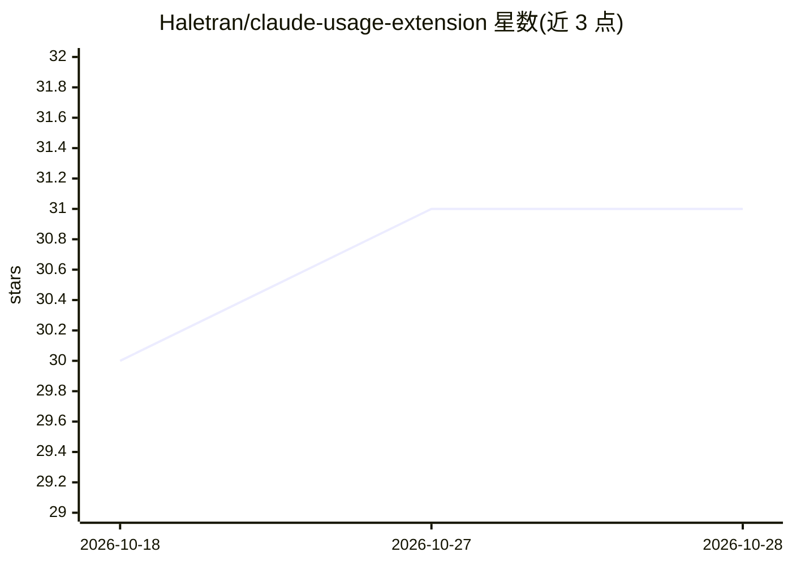

# Haletran/claude-usage-extension

⭐ 31 · JavaScript · MIT · 推送 2026-02-13 · [GitHub](https://github.com/Haletran/claude-usage-extension) · 个人维护

**GNOME Shell 扩展：在顶栏显示 Claude Code 用量百分比**

面向 GNOME 桌面用户的 Shell 扩展，在顶栏面板显示 Claude Code API 用量百分比，支持查看 5 小时与 7 天两个时间窗口的用量，并提供设置菜单调整布局与刷新时间。通过读取本地 Claude Code 凭据文件（~/.claude/.credentials.json）获取数据，要求已安装并完成认证的 Claude Code。可从 extensions.gnome.org 安装，或 git clone 手动复制到扩展目录并编译 schemas 后启用。

## 筛选速览

| 维度 | 判定 | 备注 |
|---|---|---|
| AI 角色 | `ai-ecosystem` | LLM/agent 周边工具 |
| 许可风险 | `permissive` | MIT |
| 部署形态 | `None` |  |
| 模型依赖 | — | README 未给出锁定关系 |
| 硬件要求 | — | 无带数字的原话,不猜 |
| 安装摩擦 | `low` | 无编译、无系统依赖或容器化 |
| 成熟度 | — | 结构信号不足 |

## 能力要点

- 顶栏显示 Claude Code API 用量百分比
- 支持 5 小时与 7 天用量窗口
- 设置菜单可调整布局与刷新时间
- 读取本地凭据文件，无需额外 API 配置

## 适用场景

- 在使用 Claude Code 编码时随时查看用量额度
- 避免在不知情下超出 5 小时或 7 天用量限制
- 按偏好调整顶栏显示布局与刷新频率

## 场景标签

`LLM 可观测性` · 领域:评测与运维

## 证据(README 行号)

> L4: A GNOME Shell extension that displays your Claude Code API usage percentage in the top panel.
> L14: - Claude Code installed and authenticated (`~/.claude/.credentials.json`)

## 星数曲线

2026-10-18 30 → 2026-10-28 31（+1）

---
*卡片 v1 · prompt 1.4 · 生成 2026-10-26 · 置信度 high · 依据 README sha `f0392b0ee290` · [字段定义](../../DATASET.md)*
