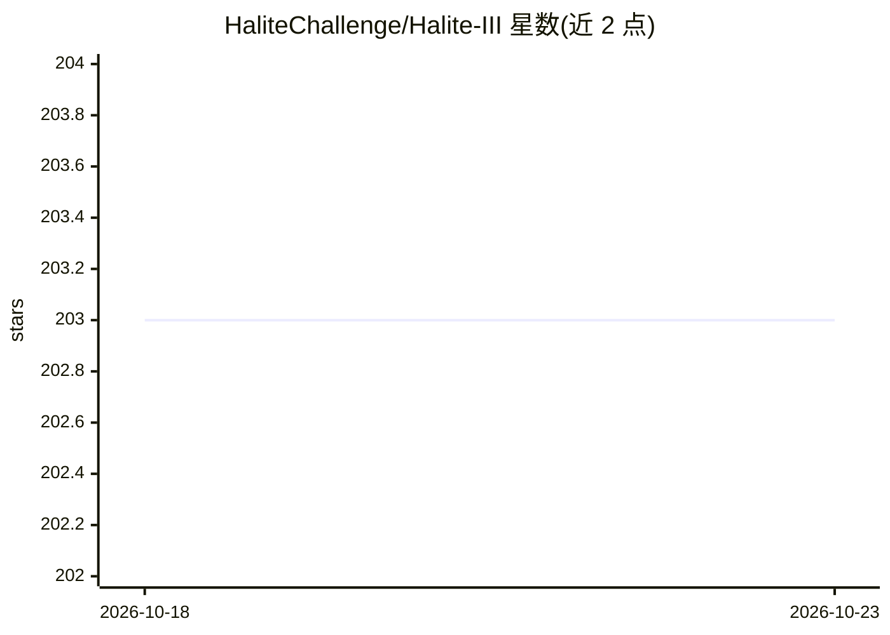

# HaliteChallenge/Halite-III

⭐ 203 · WebAssembly · MIT · 推送 2026-10-13 · [GitHub](https://github.com/HaliteChallenge/Halite-III) · 组织维护

**Two Sigma 主办的 AI 编程竞赛：写 bot 玩回合制策略游戏**

Halite III 是 Two Sigma 开发并托管的 AI 编程竞赛环境：参赛者编写 bot，在一个方形网格上的多人回合制资源管理游戏中航行于海面采集 halite。支持多种编程语言和多样化策略开发 bot。仓库为竞赛相关项目，README 提供许可证、贡献与联系方式（论坛与 halite@halite.io 邮箱），详细信息指向官方网站。

## 筛选速览

| 维度 | 判定 | 备注 |
|---|---|---|
| AI 角色 | `ai-ecosystem` | LLM/agent 周边工具 |
| 许可风险 | `permissive` | MIT |
| 部署形态 | `None` |  |
| 模型依赖 | — | README 未给出锁定关系 |
| 硬件要求 | — | 无带数字的原话,不猜 |
| 安装摩擦 | `low` | 无编译、无系统依赖或容器化 |
| 成熟度 | — | 结构信号不足 |

## 能力要点

- 多人回合制策略游戏，在方形网格上进行
- 游戏机制：AI bot 在海上导航采集 halite 资源
- 支持多种编程语言开发 bot
- 由 Two Sigma 开发并托管

## 适用场景

- 参加 Halite III 竞赛编写和调试 bot
- 以回合制策略游戏为环境练习 AI/算法编程
- 研究资源管理类博弈环境中的 bot 策略

## 场景标签

 · 领域:AI 竞赛/游戏环境

## 证据(README 行号)

> L5: Halite is an AI programming competition. Contestants write bots to play an original multi-player turn-based strategy
> L14: Halite III is developed and hosted by Two Sigma, an investment manager with a history of creating playful programmi

## 星数曲线

2026-10-18 203 → 2026-10-23 203（+0）

---
*卡片 v1 · prompt 1.4 · 生成 2026-10-22 · 置信度 mid · 依据 README sha `9d7794516435` · [字段定义](../../DATASET.md)*
