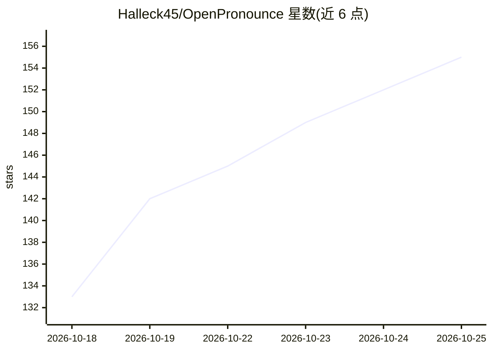

# Halleck45/OpenPronounce

⭐ 158 · Python · MIT · 推送 2026-08-15 · [GitHub](https://github.com/Halleck45/OpenPronounce) · 个人维护

**自托管英语音素级发音评测库：录音+文本→评分与错误定位**

开源发音评测工具：输入录音与目标句子，输出 0-100 评分、误读单词及实际听到的音素（IPA）、转写、音高与能量曲线。机制上用 Wav2Vec2 音素识别（espeak 标签微调）识别实际发音，espeak-ng 生成预期音素序列，经编辑距离对齐并按 CTC 置信度标记错误，另用 DTW 计算与合成母语朗读的声学距离合成总分。英语为校准语言，其他 7 种语言为实验性；可在 CPU 运行。面向语言学习应用、EdTech 与研究的开发者，以 pip 包、CLI、Python API、Docker Web 应用和 Colab 形式提供。

## 筛选速览

| 维度 | 判定 | 备注 |
|---|---|---|
| AI 角色 | `ai-native` | 本体是模型或模型工具 |
| 许可风险 | `permissive` | MIT |
| 部署形态 | `self-host` | docker 或自建部署 |
| 模型依赖 | — | README 未给出锁定关系 |
| 硬件要求 | — | 无带数字的原话,不猜 |
| 安装摩擦 | `low` | 无编译、无系统依赖或容器化 |
| 成熟度 | `idea` | |

## 能力要点

- 音素级对齐输出误读词、期望/实际 IPA 音素与置信度
- 评分 = 声学距离(DTW) + 音素错误率 + 词错误率加权，在 speechocean762 上校准（ρ=0.65）
- CPU 可运行；首次自动从 Hugging Face 下载两个 Wav2Vec2 检查点（各约 1.2GB）
- 提供 CLI、Python API、Docker Web 应用（含发音/转写/TTS 等 HTTP 端点）

## 适用场景

- 我在做语言学习 App，需要自托管、无 API key 的发音评分组件
- 我给学生录制跟读作业，想知道具体哪些音发错了
- 我做发音评测研究，需要音素错误率与声学距离等指标

## 场景标签

`语音识别` · 领域:感知与多模态

## 证据(README 行号)

> L4:  Give it a recording and the sentence it should contain. Get a score, the mispronounced words with the sounds actual
> L88: 1. A Wav2Vec2 model fine-tuned on espeak labels (`facebook/wav2vec2-lv-60-espeak-cv-ft`) recognizes the sounds actu

## 星数曲线

2026-10-18 133 → 2026-10-25 155（+22）

---
*卡片 v1 · prompt 1.4 · 生成 2026-10-22 · 置信度 high · 依据 README sha `7c059eb66334` · [字段定义](../../DATASET.md)*
