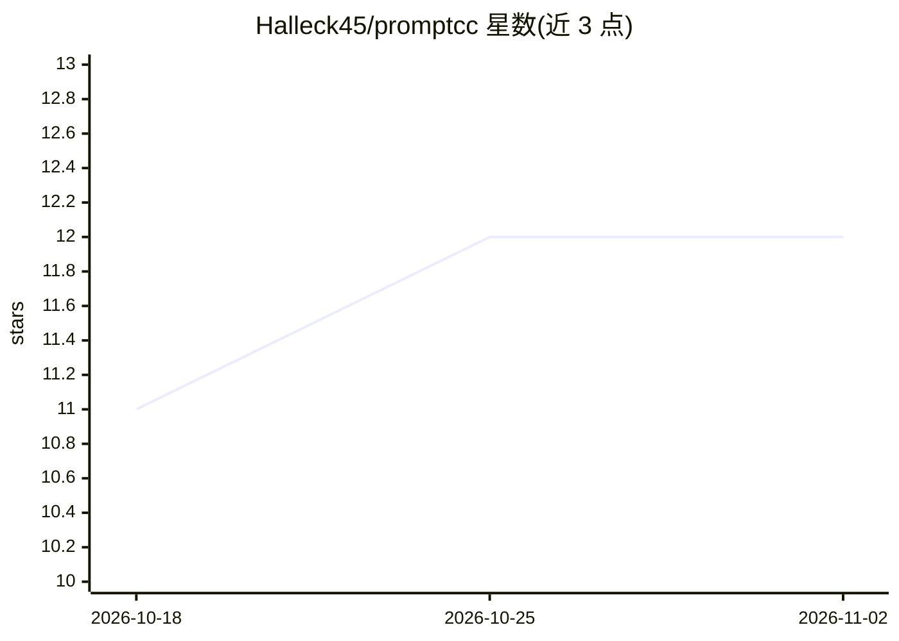

# Halleck45/promptcc

⭐ 12 · Go · MIT · 推送 2026-09-11 · [GitHub](https://github.com/Halleck45/promptcc) · [官网](https://promptcc.ast-metrics.dev/) · 个人维护

**对 LLM 提示词做静态复杂度分析与 CI 门禁的工具**

promptcc 是用 Go 编写的 CLI 静态分析工具，把圈复杂度思路应用于提示词：统计分支决策点、工具路由、注入面与输出 schema 深度并折算为一个分数，按 LOW/MODERATE/HIGH/CRITICAL 分档。它直接读取源码（Python/TypeScript/JavaScript/PHP，经 tree-sitter 解析）中的提示词，以及 CLAUDE.md、SKILL.md、agents、rules 等编码代理的 Markdown 文件，逐节评分并指出热点、缺漏引用与会静默失效的问题。支持 HTML 报告、JSON 输出、GitHub Action 与 pre-commit 钩子在 CI 中按阈值拦截。指标方向来自一篇 2026 年论文，权重为 v0 启发式。提供浏览器端 WebAssembly 演练场。

## 筛选速览

| 维度 | 判定 | 备注 |
|---|---|---|
| AI 角色 | `ai-ecosystem` | LLM/agent 周边工具 |
| 许可风险 | `permissive` | MIT |
| 部署形态 | `desktop` | 安装包/桌面程序 |
| 模型依赖 | — | README 未给出锁定关系 |
| 硬件要求 | — | 无带数字的原话,不猜 |
| 安装摩擦 | `low` | 无编译、无系统依赖或容器化 |
| 成熟度 | `idea` | |

## 能力要点

- 统计分支、路由、注入面、schema 深度并折算单一复杂度分数，分四档
- 从 Python/TS/JS/PHP 源码提取提示词，识别 Anthropic/OpenAI 等 SDK 调用并标注置信度
- 逐 Markdown 节评分、热点定位与修复建议，检查缺失引用与失效的技能描述
- GitHub Action、pre-commit 钩子与 --fail-over 实现 CI 门禁

## 适用场景

- 在 CI 中对提示词复杂度设阈值，超标即拦截
- 审计 CLAUDE.md/SKILL.md 等编码代理文件中的业务逻辑热点
- 对比多个提示词版本的复杂度变化

## 场景标签

`提示工程` · 领域:Agent 开发

## 证据(README 行号)

> L19: **promptcc** measures what actually predicts maintenance pain in a prompt: **branching, not length**. It counts dec
> L83: Every string carries a **confidence**: `high` when passed to a known LLM SDK (Anthropic, OpenAI, Google, LangChain,

## 星数曲线

2026-10-18 11 → 2026-11-02 12（+1）

---
*卡片 v1 · prompt 1.4 · 生成 2026-11-01 · 置信度 high · 依据 README sha `7d8e5a116857` · [字段定义](../../DATASET.md)*
