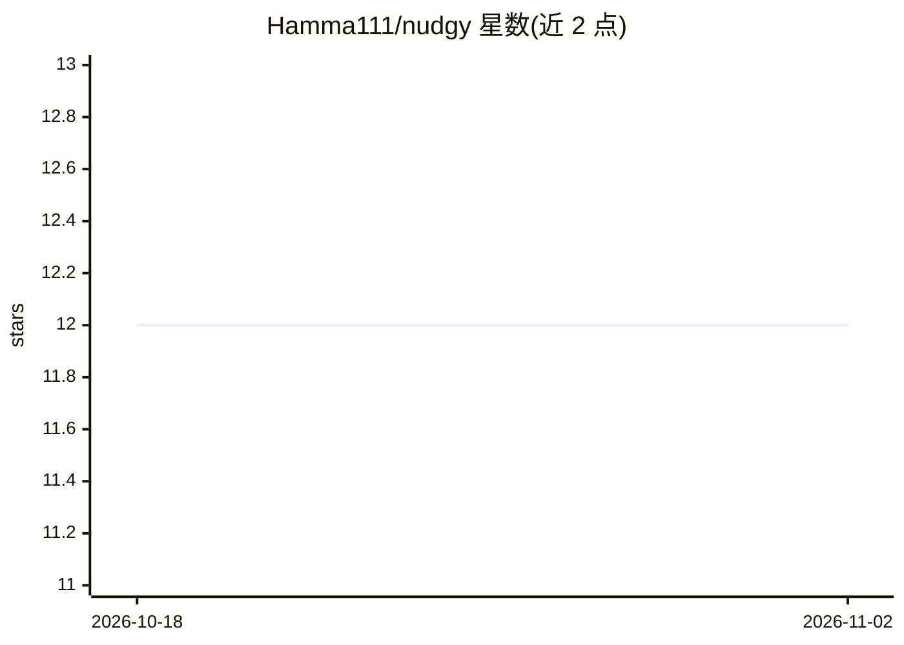

# Hamma111/nudgy

⭐ 12 · Swift · MIT · 推送 2026-09-03 · [GitHub](https://github.com/Hamma111/nudgy) · 个人维护

**macOS 菜单栏通知应用：AI 编程代理任务完成或需确认时提醒**

原生 macOS 菜单栏应用，面向使用 Claude Code 等 AI 编程代理的开发者：在 127.0.0.1:9847 运行本地 HTTP 服务器接收 Claude Code 的 hook 事件，任务完成、请求权限、提问或出错时弹出浮动通知，并提供多会话追踪、每会话 token 用量统计与通知抑制。完全本地运行，无遥测，仅监听 localhost；首次启动自动向 ~/.claude/settings.json 写入 hook 与认证 token。需要 macOS 14+ 与 Swift 5.9+，无外部依赖。

## 筛选速览

| 维度 | 判定 | 备注 |
|---|---|---|
| AI 角色 | `ai-ecosystem` | LLM/agent 周边工具 |
| 许可风险 | `permissive` | MIT |
| 部署形态 | `desktop` | 安装包/桌面程序 |
| 模型依赖 | — | README 未给出锁定关系 |
| 硬件要求 | — | 无带数字的原话,不猜 |
| 安装摩擦 | `low` | 无编译、无系统依赖或容器化 |
| 成熟度 | — | 结构信号不足 |

## 能力要点

- 本地 HTTP 服务器（127.0.0.1:9847）接收 Claude Code hook 事件并触发通知
- 多会话追踪：实时状态、注意力提醒、每会话 token 用量（解析 JSONL transcript）
- 零外部依赖，纯 SwiftUI/AppKit/Network.framework 构建
- 5 种浮动通知视觉预设与智能通知抑制

## 适用场景

- 让 Claude Code 后台跑任务时切换去做别的事，完成或有事找我时收到提醒
- 一眼追踪多个并行 agent 会话的状态与 token 消耗
- 权限请求或提问弹出即时警告，避免代理卡住干等

## 场景标签

 · 领域:开发者工具/macOS 桌面应用

## 证据(README 行号)

> L12: **Nudgy is a free, open-source macOS menu bar app that sends you native notifications when AI coding agents like Cl
> L52: ## How It Works

## 星数曲线

2026-10-18 12 → 2026-11-02 12（+0）

---
*卡片 v1 · prompt 1.4 · 生成 2026-11-01 · 置信度 high · 依据 README sha `40c6056295bd` · [字段定义](../../DATASET.md)*
