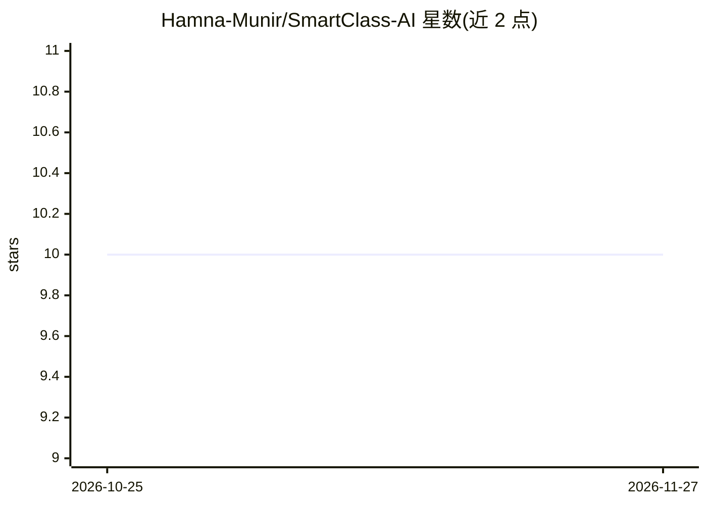

# Hamna-Munir/SmartClass-AI

⭐ 10 · Python · MIT · 推送 2026-07-16 · [GitHub](https://github.com/Hamna-Munir/SmartClass-AI) · [官网](https://smartclass-ai-27.streamlit.app/) · 个人维护

**教师用 AI 实时检测学生专注与情绪的课堂监控台**

基于 Streamlit 的课堂智能控制台：输入照片/视频/快照，经 YOLOv8（备选 OpenCV CLAHE、MediaPipe）三层人脸检测，结合 MediaPipe Face Mesh 468 个 3D 关键点、FER2013 训练的 7 类情绪 ONNX 模型与 RandomForest 专注度模型，输出个体参与度评分；按 5 条规则触发行为告警，并调用 Google Gemini 1.5 Flash 生成 3 种教学报告。面向教师/教育场景，安装需 Python 3.10+ 与 Gemini API key，模型权重首次运行自动下载，支持 CSV 导出会话历史。

## 筛选速览

| 维度 | 判定 | 备注 |
|---|---|---|
| AI 角色 | `ai-native` | 本体是模型或模型工具 |
| 许可风险 | `permissive` | MIT |
| 部署形态 | `None` |  |
| 模型依赖 | — | README 未给出锁定关系 |
| 硬件要求 | — | 无带数字的原话,不猜 |
| 安装摩擦 | `low` | 无编译、无系统依赖或容器化 |
| 成熟度 | — | 结构信号不足 |

## 能力要点

- YOLOv8→OpenCV CLAHE→MediaPipe 三层检测回退链
- FER2013 训练的 7 类情绪 ONNX 模型与 RandomForest 专注度分类
- 5 条行为告警规则（HIGH/CRITICAL/MEDIUM 分级）
- Gemini 1.5 Flash 生成 3 种教学报告

## 适用场景

- 上传课堂照片批量检测多名学生的专注状态
- 对单个学生做照片/视频深挖分析
- 生成教学报告辅助教学改进

## 场景标签

`人脸识别` · 领域:感知与多模态

## 证据(README 行号)

> L5: **SmartClass AI** is a complete **Classroom Intelligence Console** — an AI-powered system that monitors student atte
> L41: |**Primary Detection**|YOLOv8 (ultralytics)|Robust multi-face detection|
> L47: |**AI Reports**|Google Gemini 1.5 Flash|Natural language teaching reports|

## 星数曲线

2026-10-25 10 → 2026-11-27 10（+0）

---
*卡片 v1 · prompt 1.4 · 生成 2026-11-20 · 置信度 high · 依据 README sha `597f6bd2d7e7` · [字段定义](../../DATASET.md)*
