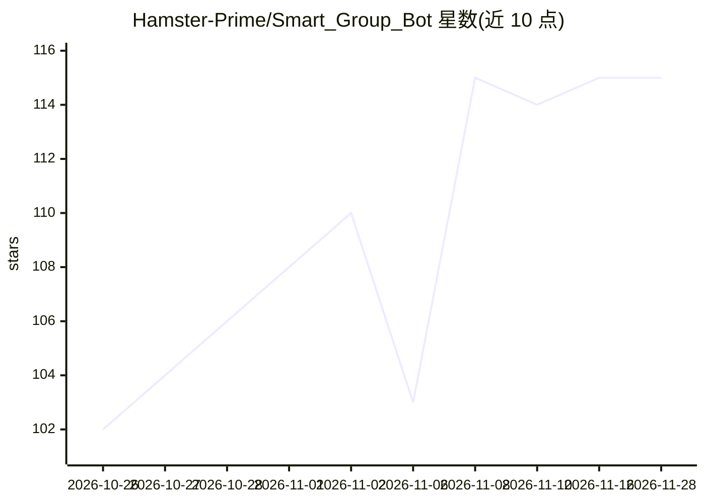

# Hamster-Prime/Smart_Group_Bot

⭐ 115 · Python · MIT · 推送 2026-11-04 · [GitHub](https://github.com/Hamster-Prime/Smart_Group_Bot) · 个人维护 · 中文 README

**面向 Telegram 群主的 LLM 群聊管理与对话机器人**

由大模型驱动的 Telegram 群聊机器人，将群组治理与聊天陪伴合并到同一消息管线：独立决策模型判断是否回复，主模型通过 function calling 调用 14 个技能（联网搜索、网页抓取、B 站等）；治理侧提供关键词/正则/LLM 语义三级内容审核、入群人机验证、资料巡检、爆破防护、投票封禁。分层记忆保留每群 500 条热窗口与 7 天档案，用 SQLite FTS5/BM25 加向量召回。基于 LiteLLM 接入多家供应商，六种模型角色可分别选型并配置 fallback。Docker 部署为主，配置经 Telegram Mini App 可视化完成，Mini App 需公网 HTTPS。

## 筛选速览

| 维度 | 判定 | 备注 |
|---|---|---|
| AI 角色 | `ai-native` | 本体是模型或模型工具 |
| 许可风险 | `permissive` | MIT |
| 部署形态 | `self-host` | docker 或自建部署 |
| 模型依赖 | locked-api |  |
| 硬件要求 | — | 无带数字的原话,不猜 |
| 安装摩擦 | `low` | 无编译、无系统依赖或容器化 |
| 成熟度 | — | 结构信号不足 |

## 能力要点

- 六种模型角色（main/decision/moderation/vision/compress/embed）分别选型并支持 fallback 降级链
- 三级内容审核：关键词、正则、LLM 语义，按置信度分级执行 warn/delete/ban
- 14 个 function calling 技能与分层记忆（FTS5/BM25 + 向量召回）
- 全部运行配置在 Telegram Mini App 内可视化完成，密钥加密入库

## 适用场景

- 管理 Telegram 群组的内容审核、入群验证与封禁流程
- 让机器人参与群聊并按需调用搜索、影视信息等技能
- 批量巡检群成员资料并防护批量入群攻击

## 场景标签

`聊天机器人` · 领域:对话与助手

## 证据(README 行号)

> L11: > 一个由大模型驱动的 Telegram 群聊智能机器人，把「聊天陪伴」和「群组治理」合并进同一条消息管线：既能自然地参与群聊、调用技能查资料，也能完成内容审核、入群验证、爆破防护和民主投票封禁。全部运行配置在 Telegram 
> L22: |🔌 **多供应商大模型**|基于 LiteLLM 接入 OpenAI / Anthropic / Gemini / 任意 OpenAI 兼容网关；main、decision、moderation、vision、compress、
> L34: |📝 **分层记忆**|每群最近 500 条热窗口 + 7 天原始消息档案；使用 SQLite FTS5/BM25 与向量召回检索旧消息，并保留发送人、时间、回复链、Telegram 消息 ID 与媒体元数据。|

## 星数曲线

2026-10-26 102 → 2026-11-28 115（+13）

---
*卡片 v1 · prompt 1.4 · 生成 2026-11-28 · 置信度 high · 依据 README sha `bb37f8f2df23` · [字段定义](../../DATASET.md)*
