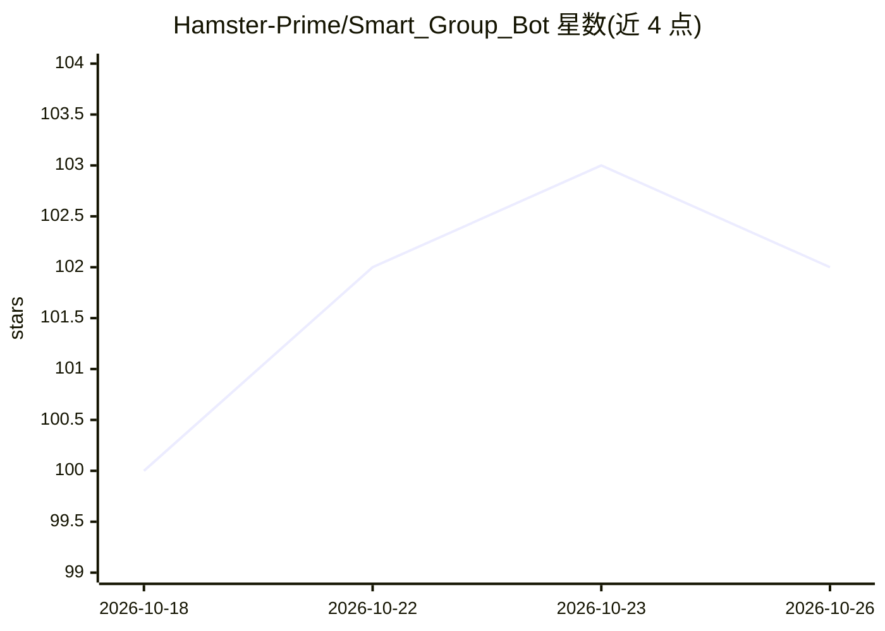

# Hamster-Prime/Smart_Group_Bot

⭐ 102 · Python · MIT · 推送 2026-09-05 · [GitHub](https://github.com/Hamster-Prime/Smart_Group_Bot) · 个人维护 · 中文 README

**LLM 驱动的 Telegram 群聊管理与陪伴机器人**

基于 aiogram 与 LiteLLM 的 Telegram 群聊机器人，将聊天陪伴与群组治理合入同一条消息管线：独立决策模型判断是否回复，六种模型角色（main/decision/moderation/vision/compress/embed）分别选型并支持 fallback 链。治理功能覆盖三级内容审核（关键词/正则/LLM 语义、置信度分级）、入群 Turnstile/hCaptcha 验证、资料筛查与全局封禁、爆破防护、民主投票封禁。另提供 14 个 function calling 技能、SQLite FTS5+向量分层记忆、贴纸学习、豆包 TTS；全部配置在 Telegram Mini App 内完成，支持 Docker 与手动部署。需将 bot 设为群管理员。

## 筛选速览

| 维度 | 判定 | 备注 |
|---|---|---|
| AI 角色 | `ai-native` | 本体是模型或模型工具 |
| 许可风险 | `permissive` | MIT |
| 部署形态 | `self-host` | docker 或自建部署 |
| 模型依赖 | locked-api |  |
| 硬件要求 | — | 无带数字的原话,不猜 |
| 安装摩擦 | `low` | 无编译、无系统依赖或容器化 |
| 成熟度 | — | 结构信号不足 |

## 能力要点

- 独立决策模型判断「该不该说话」，被 @ / 被回复必答，群友互聊保持安静
- 三级内容审核（关键词/正则/LLM 语义）按 0.0–1.0 置信度分级处置
- 六种模型角色经 LiteLLM 接入 OpenAI/Anthropic/Gemini 及任意 OpenAI 兼容网关，支持 fallback 链
- 入群人机验证（Turnstile/hCaptcha 双重可选）、爆破防护、民主投票封禁
- 分层记忆：每群 500 条热窗口 + 7 天档案，FTS5/BM25 与向量融合召回

## 适用场景

- 让 Telegram 群里有能聊天、查资料、学贴纸的 AI 成员
- 自动化群组内容审核、入群验证与广告 bot 治理
- 通过 /voteban 等命令实现群成员共治管理
- 在 Telegram Mini App 内可视化完成全部运行配置

## 场景标签

`聊天机器人` `RAG` · 领域:对话与助手

## 证据(README 行号)

> L11: > 一个由大模型驱动的 Telegram 群聊智能机器人，把「聊天陪伴」和「群组治理」合并进同一条消息管线：既能自然地参与群聊、调用技能查资料，也能完成内容审核、入群验证、爆破防护和民主投票封禁。全部运行配置在 Telegram 
> L21: |🧠 **智能决策回复**|独立的决策模型先判断「该不该说话」：被 @ 或被回复时必答，群友互聊时保持安静，避免机器人刷屏。|
> L22: |🔌 **多供应商大模型**|基于 LiteLLM 接入 OpenAI / Anthropic / Gemini / 任意 OpenAI 兼容网关；main、decision、moderation、vision、compress、

## 星数曲线

2026-10-18 100 → 2026-10-26 102（+2）

---
*卡片 v1 · prompt 1.4 · 生成 2026-10-23 · 置信度 high · 依据 README sha `8e513f49e80c` · [字段定义](../../DATASET.md)*
