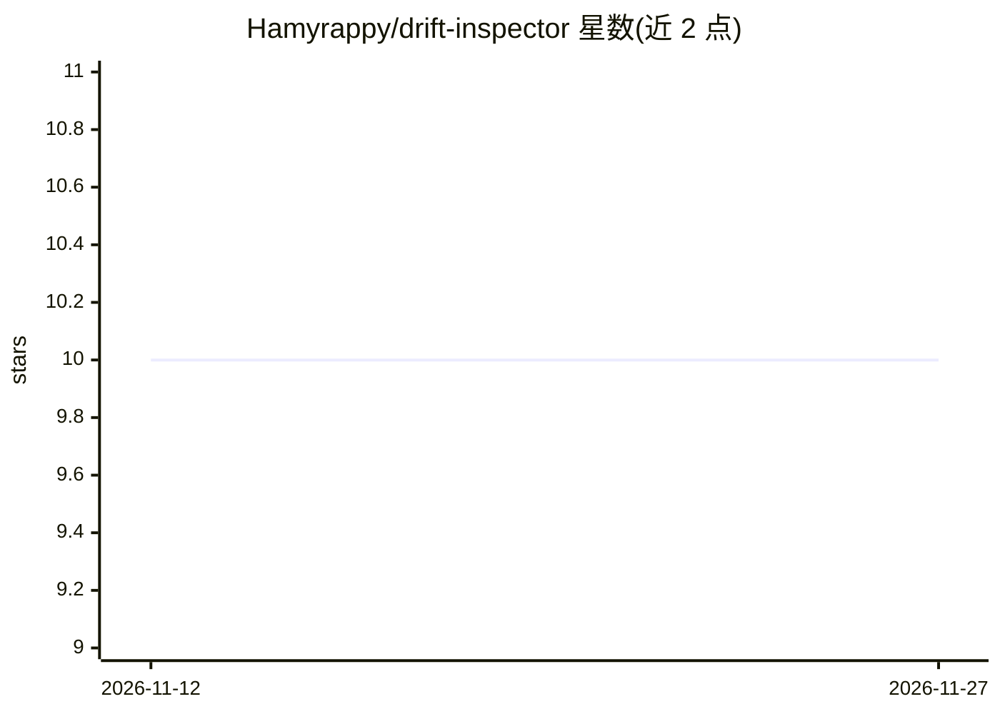

# Hamyrappy/drift-inspector

⭐ 10 · HTML · MIT · 推送 2026-11-03 · [GitHub](https://github.com/Hamyrappy/drift-inspector) · [官网](https://hamyrappy.github.io/drift-inspector/) · 个人维护

**用 LLM 抽取贡献声明来度量科研领域漂移的工具**

面向科学计量场景的分析工具：先用 LLM 从论文摘要中抽取原子贡献声明（ACC），再用 SPECTER2 嵌入、UMAP 降维、HDBSCAN 聚类，生成可交互的 WebGL 静态地图，支持年份回放、漂移叠加、全文声明检索与队列对比。演示实例覆盖 ACL 系六个会议 2018–2026 语料；LLM 阶段调用 OpenAI 兼容端点（OpenRouter），下游步骤在 CPU 本地运行；附带 EMNLP 2026 系统演示论文与可复现的分析 notebook。

## 筛选速览

| 维度 | 判定 | 备注 |
|---|---|---|
| AI 角色 | `ai-native` | 本体是模型或模型工具 |
| 许可风险 | `permissive` | MIT |
| 部署形态 | `None` |  |
| 模型依赖 | locked-api |  |
| 硬件要求 | — | 无带数字的原话,不猜 |
| 安装摩擦 | `low` | 无编译、无系统依赖或容器化 |
| 成熟度 | — | 结构信号不足 |

## 能力要点

- LLM 抽取的原子贡献声明作为分析单元，与摘要背景分离
- SPECTER2 + UMAP + HDBSCAN 联合聚类，静态 HTML 交付，种子固定且 uv.lock 锁定版本可复现
- 五个视图：地图、趋势、聚类、对比、方法
- 附带人工验证、编码器/抽取器消融与 36 格鲁棒性网格等评估产物

## 适用场景

- 探索某个会议或领域的研究主题如何随年份演变
- 对比两个作者群/会议/年份区间的主题画像
- 在自己的会议语料上构建声明级漂移地图

## 场景标签

`科研工具` · 领域:学习与行业

## 证据(README 行号)

> L16: *produces* from what it merely *discusses*. Drift Inspector measures how a
> L18: (ACCs)** — self-contained, contribution-bearing propositions that an LLM
> L100: The LLM stages (2, 3, 6) call an OpenAI-compatible endpoint: set

## 星数曲线

2026-11-12 10 → 2026-11-27 10（+0）

---
*卡片 v1 · prompt 1.4 · 生成 2026-11-20 · 置信度 high · 依据 README sha `6644e26c8cd9` · [字段定义](../../DATASET.md)*
