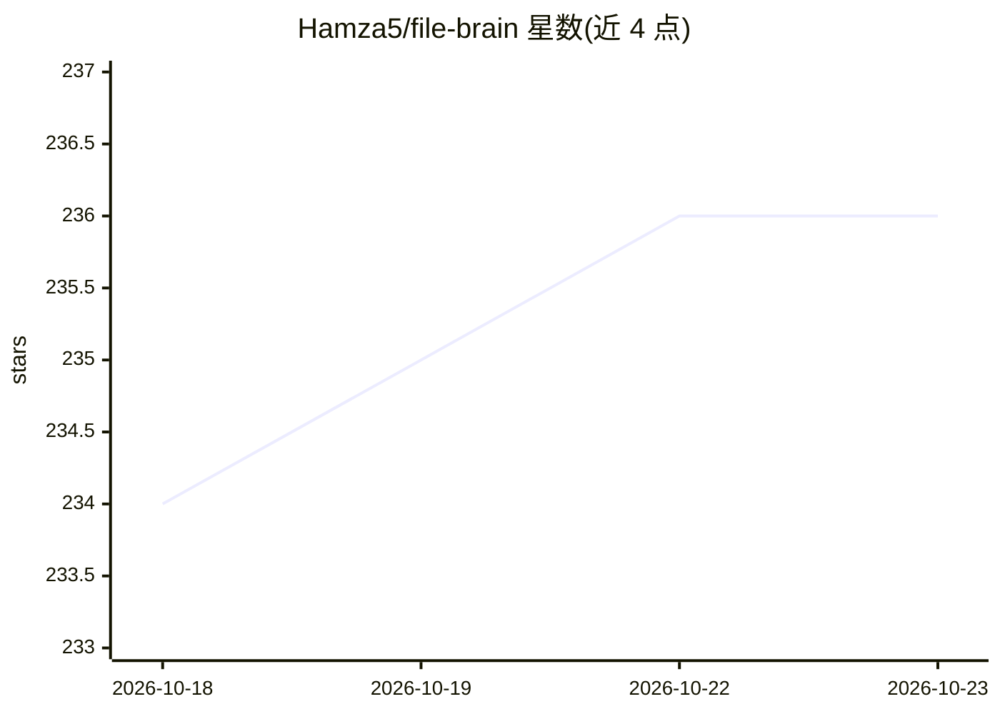

# Hamza5/file-brain

⭐ 236 · Python · GPL-3.0 · 推送 2026-04-10 · [GitHub](https://github.com/Hamza5/file-brain) · [官网](https://file-brain.com/) · 个人维护

**本地桌面文件语义搜索应用：用自然语言找文件**

跨平台桌面应用，对本地文件建立索引并通过语义搜索、全文搜索与模糊匹配查找文件，支持 OCR、跨语言检索、1000+ 格式内容提取（基于 Apache Tika），可实时监测文件变化自动更新索引。所有索引与处理在本机完成，不修改用户文件。运行需 Python 3.11+ 与 Docker，首次启动有初始化向导下载嵌入模型（ts_paraphrase-multilingual-mpnet-base-v2 ONNX 版）并拉起 Typesense/Tika 后台服务；也支持 NVIDIA GPU 加速索引与手动部署。PRO 版本（文档问答、视频搜索等）尚在开发中，未发布。

## 筛选速览

| 维度 | 判定 | 备注 |
|---|---|---|
| AI 角色 | `ai-enhanced` | 去掉 AI 部分产品仍成立 |
| 许可风险 | `viral` | GPL-3.0 |
| 部署形态 | `self-host` | docker 或自建部署 |
| 模型依赖 | — | README 未给出锁定关系 |
| 硬件要求 | — | 无带数字的原话,不猜 |
| 安装摩擦 | `low` | 无编译、无系统依赖或容器化 |
| 成熟度 | — | 结构信号不足 |

## 能力要点

- 语义+全文+模糊搜索，抗拼写错误与跨语言检索
- OCR 提取截图与扫描件文本，支持 1000+ 文件格式
- 100% 本地索引与处理，只读不修改用户文件
- 初始化向导自动下载嵌入模型并启动 Docker 后台服务，支持 GPU 加速

## 适用场景

- 不记得文件名时用自然语言描述内容找到文件
- 搜索截图、扫描件等图片中的文字
- 跨语言查找用其他语言写成的文档

## 场景标签

`语义搜索` `OCR` · 领域:知识与检索

## 证据(README 行号)

> L24: File Brain is a desktop application that helps you find files instantly using natural language. Instead of remember
> L28: - **🧠 Find what you mean**: Uses advanced Semantic Search -in addition to full text search- to understand the inten
> L79:  5. **Download Embedding Model**: Fetches the embedding model for intelligent search.

## 星数曲线

2026-10-18 234 → 2026-10-23 236（+2）

---
*卡片 v1 · prompt 1.4 · 生成 2026-10-22 · 置信度 mid · 依据 README sha `0396aaa8200d` · [字段定义](../../DATASET.md)*
