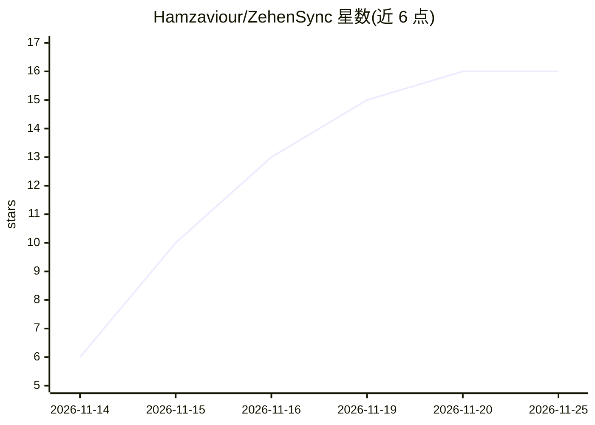

# Hamzaviour/ZehenSync

⭐ 16 · HTML · 推送 2026-11-22 · [GitHub](https://github.com/Hamzaviour/ZehenSync) · [官网](https://zehensync-landing.vercel.app) · 组织维护

**面向患者与心理医生的多模态心理健康筛查辅助平台**

ZehenSync 定位为心理健康领域的多模态筛查支持平台，服务对象为患者、执业心理医生与心理学专业学生；平台声明只做筛查、不做诊断，所有临床决定由持证心理医生作出。仓库按 monorepo 组织：docs/ 为 Obsidian 知识库（PRD、TRD、流程、架构、追踪器），source-docs/ 保存原始提案与报告，apps/ 下为 Next.js 前端与 FastAPI 后端，packages/instruments/ 存放版本化问卷定义与计分逻辑。当前处于 Phase 0（文档与品牌）阶段，前后端与问卷包为后续阶段内容，README 未给出安装与运行步骤。

## 筛选速览

| 维度 | 判定 | 备注 |
|---|---|---|
| AI 角色 | `ai-native` | 本体是模型或模型工具 |
| 许可风险 | `none` | — |
| 部署形态 | `None` |  |
| 模型依赖 | — | README 未给出锁定关系 |
| 硬件要求 | — | 无带数字的原话,不猜 |
| 安装摩擦 | `low` | 无编译、无系统依赖或容器化 |
| 成熟度 | `idea` | |

## 能力要点

- 多模态心理健康筛查支持，明确声明筛查不诊断
- monorepo 结构：Next.js 前端、FastAPI 后端、版本化问卷定义与计分包
- docs/ 提供完整 Obsidian 文档库（PRD/TRD/流程/架构/追踪器）
- 分阶段开发，Phase 0 文档阶段进行中

## 适用场景

- 心理筛查流程中辅助收集与计分问卷信息
- 心理医生将平台用作筛查支持工具，最终判断由人工作出
- 心理学专业学生参与筛查相关工作流程

## 场景标签

`多模态` · 领域:感知与多模态

## 证据(README 行号)

> L3: A multimodal screening-support platform for mental health. It serves patients, psychologists, and psychology student
> L5: ZehenSync screens and never diagnoses. A licensed psychologist makes every clinical decision.
> L27: Phase 0 (documentation and brand) in progress. See `docs/05-Planning/Tracker.md`.

## 星数曲线

2026-11-14 6 → 2026-11-25 16（+10）

---
*卡片 v1 · prompt 1.4 · 生成 2026-11-18 · 置信度 mid · 依据 README sha `3fc4b4eed9f6` · [字段定义](../../DATASET.md)*
