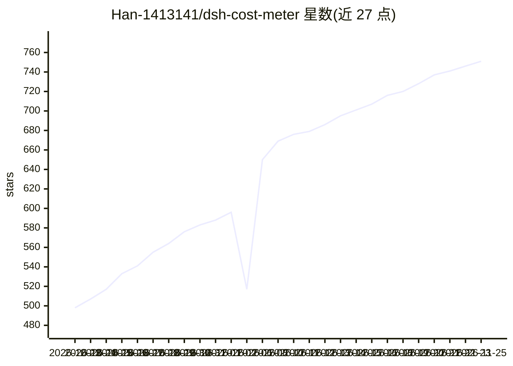

# Han-1413141/dsh-cost-meter

⭐ 751 · JavaScript · MIT · 推送 2026-11-23 · [GitHub](https://github.com/Han-1413141/dsh-cost-meter) · 个人维护 · 中文 README

**为 DeepSeek Harness 提供会话成本、token 用量与配额追踪的插件**

以 DSH 插件形式安装的成本追踪工具：按会话、模型与调用维度记录费用与 token 用量，支持多 provider 定价（峰谷分时费率、可编辑倍率）、每日/每月/累计预算与峰谷切换提醒，并汇总 Codex、Claude、GLM、Kimi 等订阅配额与账户余额，区分 API 费用与 Plan 等价值。提供统计趋势、排名、缓存命中率与导出功能，中英双语 UI，深色主题与移动端布局。

## 筛选速览

| 维度 | 判定 | 备注 |
|---|---|---|
| AI 角色 | `ai-ecosystem` | LLM/agent 周边工具 |
| 许可风险 | `permissive` | MIT |
| 部署形态 | `None` |  |
| 模型依赖 | locked-api |  |
| 硬件要求 | — | 无带数字的原话,不猜 |
| 安装摩擦 | `low` | 无编译、无系统依赖或容器化 |
| 成熟度 | — | 结构信号不足 |

## 能力要点

- 按会话、模型与调用记录成本与 token 用量，含父/子 agent 成本归属
- 峰谷分时定价同步、预算设定与切换前弹窗/系统通知
- 聚合多 provider 订阅配额与余额，支持自定义 HTTP 余额来源
- 中英双语 UI、深色主题与移动端布局

## 适用场景

- 追踪 DeepSeek Harness 各会话的 token 花费与缓存命中率
- 为团队设置每日/每月 API 预算并在峰谷切换前收到提醒
- 统一查看多个 provider 的订阅配额与账户余额

## 场景标签

`LLM 可观测性` · 领域:评测与运维

## 证据(README 行号)

> L3:  Cost tracking and subscription quotas for DeepSeek Harness
> L13: Track costs and tokens by conversation, model and call. View account balances, subscription quotas and budgets toge

## 星数曲线

2026-10-23 498 → 2026-11-25 751（+253）

---
*卡片 v1 · prompt 1.4 · 生成 2026-11-25 · 置信度 high · 依据 README sha `9a3e3105bc14` · [字段定义](../../DATASET.md)*
