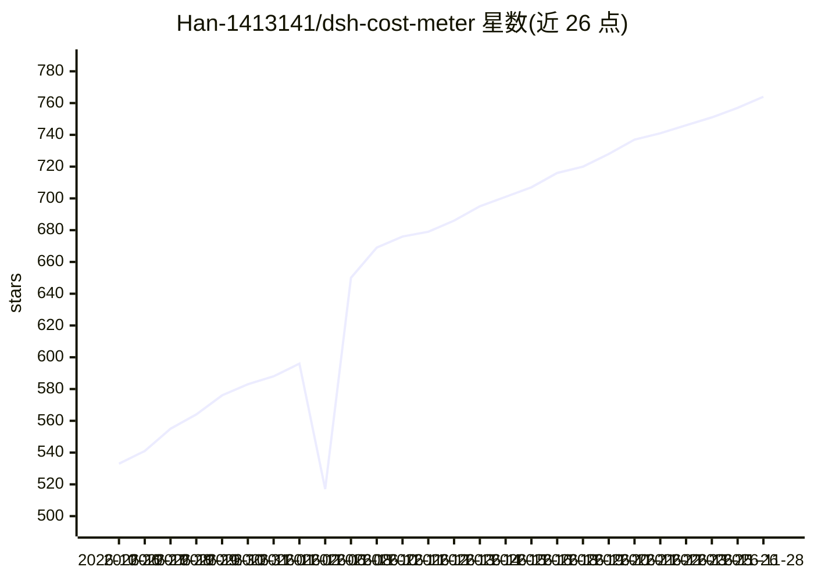

# Han-1413141/dsh-cost-meter

⭐ 764 · JavaScript · MIT · 推送 2026-11-26 · [GitHub](https://github.com/Han-1413141/dsh-cost-meter) · 个人维护 · 中文 README

**为 DeepSeek Harness 记录会话与模型成本、用量与配额的插件**

以 DSH 插件形式安装的成本跟踪工具，按会话、模型和调用记录成本与 token 用量，聚合显示账户余额、订阅配额与预算，区分 API 计费与 Plan 等价成本；支持多提供商定价、峰谷计费提醒、缓存命中率统计与用量热力图，可导出对话数据。提供中英文界面、明暗主题与移动端布局。要求 Node.js ≥ 20 与 DSH 0.2.0 以上，通过 dsh plugin 命令或 Windows PowerShell 安装器安装。

## 筛选速览

| 维度 | 判定 | 备注 |
|---|---|---|
| AI 角色 | `ai-ecosystem` | LLM/agent 周边工具 |
| 许可风险 | `permissive` | MIT |
| 部署形态 | `None` |  |
| 模型依赖 | locked-api |  |
| 硬件要求 | — | 无带数字的原话,不猜 |
| 安装摩擦 | `low` | 无编译、无系统依赖或容器化 |
| 成熟度 | — | 结构信号不足 |

## 能力要点

- 按会话/模型/调用维度记录成本与 token 用量，含父子子代理成本归因
- 聚合 Codex/ChatGPT、Claude、GLM、Kimi 等订阅配额与多账户余额
- 峰谷计费时段提醒与日/月/累计预算控制
- 同步 DeepSeek 官方价格与 OpenRouter 目录，费率可编辑

## 适用场景

- 跟踪 DSH 会话中每次调用的 token 花费与费用趋势
- 在一个界面查看多家模型订阅配额与账户余额
- 设置日/月预算并在峰谷计费切换前收到通知

## 场景标签

`LLM 可观测性` · 领域:评测与运维

## 证据(README 行号)

> L3:  Cost tracking and subscription quotas for DeepSeek Harness
> L13: Track costs and tokens by conversation, model and call. View account balances, subscription quotas and budgets toge
> L24: Requires **Node.js ≥ 20, DSH 0.2.0 or later**, and pnpm available to DSH. See host compatibility.

## 星数曲线

2026-10-26 533 → 2026-11-28 764（+231）

---
*卡片 v1 · prompt 1.4 · 生成 2026-11-27 · 置信度 high · 依据 README sha `ffa133124883` · [字段定义](../../DATASET.md)*
