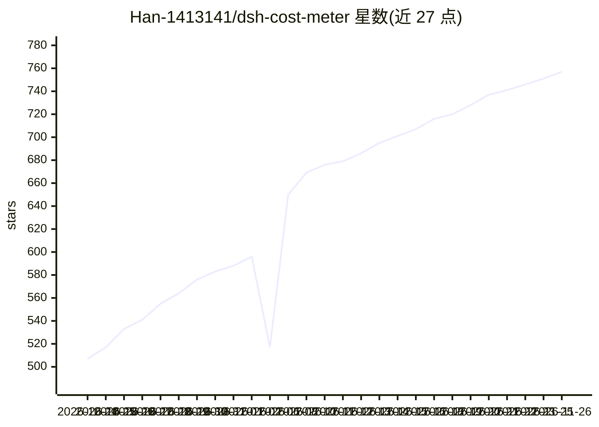

# Han-1413141/dsh-cost-meter

⭐ 757 · JavaScript · MIT · 推送 2026-11-25 · [GitHub](https://github.com/Han-1413141/dsh-cost-meter) · 个人维护

**为 DeepSeek Harness 用户提供会话成本、token 用量与配额追踪插件**

以 DSH 插件形式安装的成本与用量面板：按会话、模型、调用粒度记录费用与 token，统计缓存命中率、趋势与排名，支持导出。集成多种订阅套餐配额（Codex/ChatGPT、Claude、GLM、Kimi、Qianwen 等）与 CLIProxyAPI 多账户配额、自定义 HTTP 余额源；同步 DeepSeek 官方价格与 OpenRouter 目录，区分 API 计费与套餐等效额；提供日/月/累计预算与峰谷时段提醒。界面中英双语，支持深色主题与移动端布局。

## 筛选速览

| 维度 | 判定 | 备注 |
|---|---|---|
| AI 角色 | `ai-ecosystem` | LLM/agent 周边工具 |
| 许可风险 | `permissive` | MIT |
| 部署形态 | `None` |  |
| 模型依赖 | locked-api |  |
| 硬件要求 | — | 无带数字的原话,不猜 |
| 安装摩擦 | `low` | 无编译、无系统依赖或容器化 |
| 成熟度 | — | 结构信号不足 |

## 能力要点

- 按会话/模型/调用记录成本与 token，含父子 agent 成本归因
- 聚合多提供商套餐配额与账户余额显示
- 峰谷计费时段提醒与自定义预算控制
- 中英双语界面，支持侧边栏/输入框多种布局

## 适用场景

- 追踪 DeepSeek Harness 各会话的 API 花费与 token 消耗
- 设置月度/日预算并在计费时段切换前收到提醒
- 集中查看多个模型订阅套餐的配额窗口与余额

## 场景标签

`LLM 可观测性` · 领域:评测与运维

## 证据(README 行号)

> L3:  Cost tracking and subscription quotas for DeepSeek Harness
> L13: Track costs and tokens by conversation, model and call. View account balances, subscription quotas and budgets toge
> L24: Requires **Node.js ≥ 20, DSH 0.2.0 or later**, and pnpm available to DSH. See host compatibility.

## 星数曲线

2026-10-24 507 → 2026-11-26 757（+250）

---
*卡片 v1 · prompt 1.4 · 生成 2026-11-26 · 置信度 high · 依据 README sha `d368a67df71f` · [字段定义](../../DATASET.md)*
