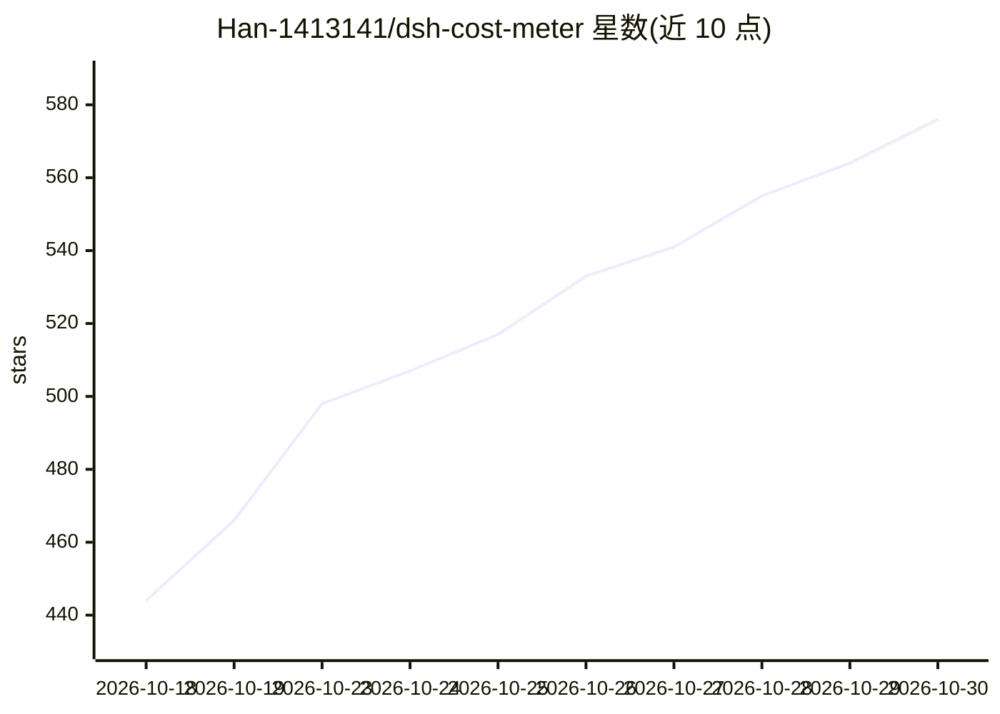

# Han-1413141/dsh-cost-meter

⭐ 576 · JavaScript · MIT · 推送 2026-10-29 · [GitHub](https://github.com/Han-1413141/dsh-cost-meter) · 个人维护 · 中文 README

**DeepSeek Harness 的成本追踪插件：会话费用、token 用量与配额监控**

面向 DeepSeek Harness（DSH）web GUI 的会话成本追踪插件，提供中英双语 UI。功能包括：按会话/按日/按周期的成本统计与趋势、每模型成本卡片、官方与自定义供应商余额查询、预算与超额提醒、OpenCode Go 及多家厂商 Coding Plan 配额查询（Anthropic/Z.ai/MiniMax/Kimi/OpenRouter 等）、峰谷时段定价显示、170+ 模型 ID 价格目录与一键同步、SQLite/JSONL 会话存储的历史回填。声明最低宿主版本 DSH 0.2.0，需在宿主内以插件方式安装。

## 筛选速览

| 维度 | 判定 | 备注 |
|---|---|---|
| AI 角色 | `ai-ecosystem` | LLM/agent 周边工具 |
| 许可风险 | `permissive` | MIT |
| 部署形态 | `library` | 以包/库形式分发 |
| 模型依赖 | locked-api |  |
| 硬件要求 | — | 无带数字的原话,不猜 |
| 安装摩擦 | `low` | 无编译、无系统依赖或容器化 |
| 成熟度 | — | 结构信号不足 |

## 能力要点

- 会话/日/周/月成本统计、模型与会话排名、预算与超额告警
- 多家厂商 Coding Plan 配额查询（Anthropic/Z.ai/MiniMax/Kimi/OpenRouter 等 13 家）
- 峰谷时段（UTC）定价显示与中国节假日全天谷价判定
- 内置 170+ 模型 ID 价格目录自动匹配，安装后自动回填历史会话

## 适用场景

- 我在用 DeepSeek Harness 时想实时看到每次对话花了多少钱
- 我订阅了多家 Coding Plan，想在侧边栏统一查看剩余配额
- 我想设置月度预算并在超额前收到峰谷切换提醒

## 场景标签

`LLM 可观测性` · 领域:评测与运维

## 证据(README 行号)

> L5: **Session cost tracking plugin for the DeepSeek Harness web GUI (bilingual UI)**
> L29: **Minimum supported host: DSH 0.2.0.** The plugin declares the floor in `engines.dsh`, the host's admission gate fo
> L25: Per-conversation cost · daily totals · OpenCode Go subscription quota display · budget with usage percentage · offi

## 星数曲线

2026-10-18 444 → 2026-10-30 576（+132）

---
*卡片 v1 · prompt 1.4 · 生成 2026-10-22 · 置信度 high · 依据 README sha `b63a25c9b522` · [字段定义](../../DATASET.md)*
