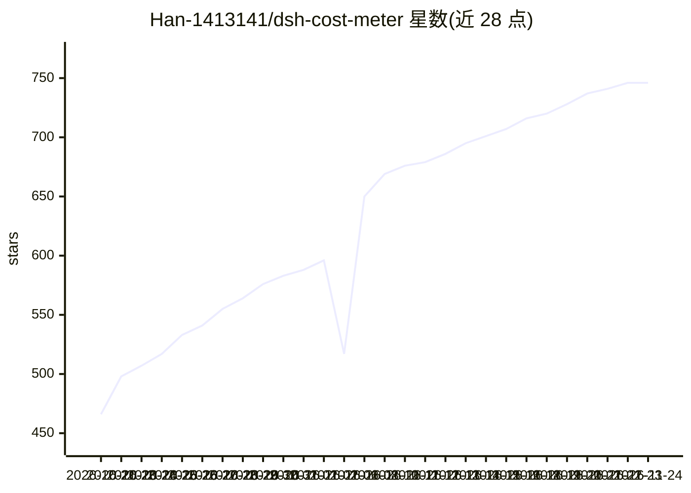

# Han-1413141/dsh-cost-meter

⭐ 746 · JavaScript · MIT · 推送 2026-11-22 · [GitHub](https://github.com/Han-1413141/dsh-cost-meter) · 个人维护 · 中文 README

**DeepSeek Harness 的成本与额度追踪插件**

以 DSH 插件形式安装的用量与成本面板：按会话、模型和调用记录费用与 token，聚合各订阅计划额度与账户余额，区分 API 计费与 Plan 等价成本，支持多服务商定价、峰谷时段提醒与日/月/累计预算。提供中英双语界面、深浅主题、统计导出与历史导入，含父/子 agent 成本归因。需 Node.js ≥20、DSH 0.2.0+ 与 pnpm，桌面端另有安装器。

## 筛选速览

| 维度 | 判定 | 备注 |
|---|---|---|
| AI 角色 | `ai-ecosystem` | LLM/agent 周边工具 |
| 许可风险 | `permissive` | MIT |
| 部署形态 | `None` |  |
| 模型依赖 | locked-api |  |
| 硬件要求 | — | 无带数字的原话,不猜 |
| 安装摩擦 | `low` | 无编译、无系统依赖或容器化 |
| 成熟度 | — | 结构信号不足 |

## 能力要点

- 按会话、模型、调用维度追踪成本与 token，含子 agent 成本归因
- 聚合 Codex/ChatGPT、Claude、GLM、Kimi 等多计划额度与自定义余额源
- 同步 DeepSeek 官方价格与 OpenRouter 目录，峰谷定价分级与提醒
- 中英双语 UI、预算管理与用量导出

## 适用场景

- 使用 DeepSeek Harness 时掌握每次会话的 token 与费用明细
- 为多个模型订阅计划设置预算并在超支前收到提醒
- 按日期、服务商、模型筛选导出用量做账目统计

## 场景标签

`LLM 可观测性` · 领域:评测与运维

## 证据(README 行号)

> L3:  Cost tracking and subscription quotas for DeepSeek Harness
> L13: Track costs and tokens by conversation, model and call. View account balances, subscription quotas and budgets toge
> L27: dsh plugin --profile web add dsh-cost-meter

## 星数曲线

2026-10-21 466 → 2026-11-24 746（+280）

---
*卡片 v1 · prompt 1.4 · 生成 2026-11-24 · 置信度 high · 依据 README sha `e6c503d28005` · [字段定义](../../DATASET.md)*
