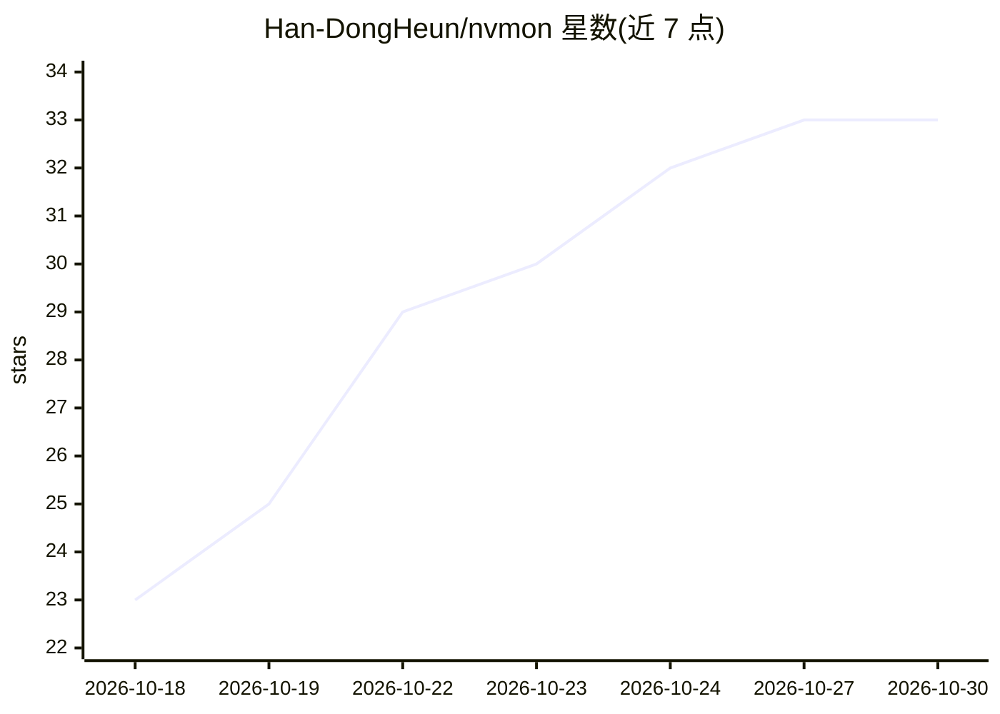

# Han-DongHeun/nvmon

⭐ 33 · Python · MIT · 推送 2026-10-21 · [GitHub](https://github.com/Han-DongHeun/nvmon) · [官网](https://pypi.org/project/nvmon/) · 个人维护

**终端中的 NVIDIA GPU 监视器：单 Python 文件、零依赖**

基于 NVML 的终端 GPU 监视工具，以单文件 Python 实现、无第三方依赖，支持离线服务器拷贝运行。展示 GPU 利用率/显存曲线、功耗温度、PCIe 流量、按账户与 conda 环境分组的进程/作业树（识别 torchrun、deepspeed 等启动器及其 worker），可对作业发 SIGTERM/SIGKILL，提供四种视图、多主题与每主机配置记忆。面向共享 GPU 服务器（如 H100 集群）上的深度学习使用者。

## 筛选速览

| 维度 | 判定 | 备注 |
|---|---|---|
| AI 角色 | `ai-ecosystem` | LLM/agent 周边工具 |
| 许可风险 | `permissive` | MIT |
| 部署形态 | `library` | 以包/库形式分发 |
| 模型依赖 | — | README 未给出锁定关系 |
| 硬件要求 | — | 无带数字的原话,不猜 |
| 安装摩擦 | `low` | 无编译、无系统依赖或容器化 |
| 成熟度 | — | 结构信号不足 |

## 能力要点

- 单 Python 文件、零依赖，可无安装直接运行（Python 3.6.1+）
- 按账户/conda 环境分组的进程树，识别 torchrun、deepspeed 等 launcher 及 worker
- 显示利用率/显存曲线、Tensor Core 占用（H100 及更新）、PCIe 流量与降速告警
- 四种视图、十余种主题、按连接主机记忆设置

## 适用场景

- 在共享 GPU 服务器上查看自己和他人的训练任务占用
- 通过 ssh 在终端实时监控多卡利用率与显存
- 对失控的训练作业直接终止或杀死
- 在窄窗口侧边以纯数字模式常驻显示 GPU 状态

## 场景标签

 · 领域:系统监控/深度学习基础设施

## 证据(README 行号)

> L3: A fancy NVIDIA GPU monitor for the terminal. One Python file, no dependencies.

## 星数曲线

2026-10-18 23 → 2026-10-30 33（+10）

---
*卡片 v1 · prompt 1.4 · 生成 2026-10-26 · 置信度 high · 依据 README sha `29787a013eae` · [字段定义](../../DATASET.md)*
