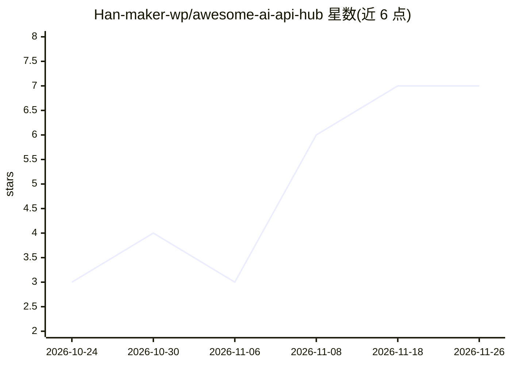

# Han-maker-wp/awesome-ai-api-hub

⭐ 7 · HTML · MIT · 推送 2026-10-16 · [GitHub](https://github.com/Han-maker-wp/awesome-ai-api-hub) · 个人维护 · 中文 README

**面向开发者的 AI API 中转站/聚合网关精选清单（102 站）**

收录 102 个站点的信息聚合清单，按两大类组织：AI 相关（中转站/聚合平台、官方直连、API 检测验真、导航比价、账号服务、开源自建网关）与通用基础设施（网络代理、机场评测、IP 检测、账号接码）。每条链接标注核实状态与标签，内置单文件导航页 index.html 支持搜索筛选，提供 data/sites.json 数据文件与 Python 链接检测、导航页生成脚本。项目自身不运营任何服务。

## 筛选速览

| 维度 | 判定 | 备注 |
|---|---|---|
| AI 角色 | `ai-knowledge` | 知识聚合/清单类 |
| 许可风险 | `permissive` | MIT |
| 部署形态 | `None` |  |
| 模型依赖 | — | README 未给出锁定关系 |
| 硬件要求 | — | 无带数字的原话,不猜 |
| 安装摩擦 | `low` | 无编译、无系统依赖或容器化 |
| 成熟度 | — | 结构信号不足 |

## 能力要点

- 收录 102 个站点，分 2 大类多个子分类并标注核实状态
- 内置可搜索筛选的单文件导航页，可直接部署 GitHub Pages
- 提供 data/sites.json 数据文件与链接检测/导航页生成脚本
- 含防坑指南与按使用场景的选型决策表

## 适用场景

- 找能用支付宝/微信充值的国内可直连大模型 API 入口
- 充值前查找模型真伪与掺水率的检测验真站
- 对比各中转站报价与在线率做选型功课
- 了解 one-api/new-api 等开源自建网关选项

## 场景标签

`精选清单` `模型网关` · 领域:Agent 开发

## 证据(README 行号)

> L5: 精选 **102** 个站点，分两大类别：**AI 相关**（中转站 / 聚合网关 / 官方直连 / 比价导航 / 自建方案）与 **AI 无关 · 通用基础设施**（网络代理 / 机场评测 / 网络工具 / 账号接码）
> L33: 这个仓库把这类入口**按用途分两大类整理好**，并标注每条链接的核实状态，省得你在无数个「AI 导航站」之间来回跳。

## 星数曲线

2026-10-24 3 → 2026-11-26 7（+4）

---
*卡片 v1 · prompt 1.4 · 生成 2026-11-20 · 置信度 high · 依据 README sha `72490f5faf3c` · [字段定义](../../DATASET.md)*
