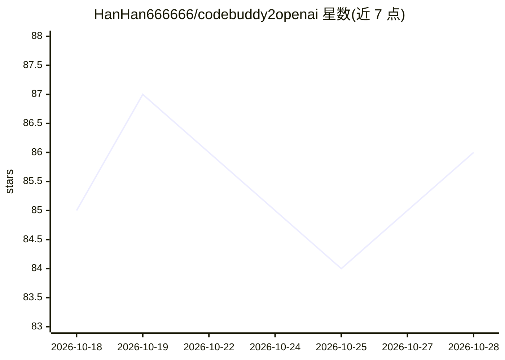

# HanHan666666/codebuddy2openai

⭐ 86 · Python · MIT · 推送 2026-09-22 · [GitHub](https://github.com/HanHan666666/codebuddy2openai) · [官网](https://github.com/HanHan666666/codebuddy2openai) · 个人维护 · 中文 README

**把 CodeBuddy 订阅转成 OpenAI 兼容 API 的本地转换器**

单文件本地协议转换器（FastAPI，核心为 converter.py）：读取本机已登录的 CodeBuddy/WorkBuddy（腾讯代码助手）桌面端凭据，将其后端（copilot.tencent.com，原生 OpenAI chat/completions 协议）包装为本地 /v1/chat/completions、/v1/models、/health 接口，支持流式 SSE 与 function calling（tools/tool_calls 透传），token 过期自动刷新。供 ZCode、Cherry Studio、NextChat、LobeChat 等 OpenAI 兼容客户端接入 glm-5.2、kimi-k2.7、deepseek-v4-pro 等模型。限制：新版 Codex CLI 已不支持该 wire_api，无法直接接入；默认仅监听 127.0.0.1。需 Python 3.8+ 并已登录桌面端。

## 筛选速览

| 维度 | 判定 | 备注 |
|---|---|---|
| AI 角色 | `ai-ecosystem` | LLM/agent 周边工具 |
| 许可风险 | `permissive` | MIT |
| 部署形态 | `library` | 以包/库形式分发 |
| 模型依赖 | — | README 未给出锁定关系 |
| 硬件要求 | — | 无带数字的原话,不猜 |
| 安装摩擦 | `low` | 无编译、无系统依赖或容器化 |
| 成熟度 | — | 结构信号不足 |

## 能力要点

- OpenAI 兼容接口 /v1/chat/completions（流式 SSE）、/v1/models、/health
- function calling 由后端原生支持，tool_calls 透传，无 prompt 注入或文本解析
- 复用桌面端登录态，token 过期自动刷新，不重新登录不存密码
- 可选 --desensitize 脱敏模块与 --log 完整报文落盘日志

## 适用场景

- 在 Cherry Studio / ZCode 等 OpenAI 兼容客户端里复用 CodeBuddy 订阅的模型
- 让任意支持自定义 base_url 的 OpenAI SDK 客户端调用 glm/kimi/deepseek 模型
- 本地代理方式使用订阅额度并排查内容审核拦截问题

## 场景标签

`模型网关` · 领域:Agent 开发

## 证据(README 行号)

> L13: 一个极简的本地协议转换器（proxy / adapter）：读取你本机已登录的 CodeBuddy 桌面端凭据，把它的对话能力包装成标准的 OpenAI `/v1/chat/completions`、`/v1/models` 接口
> L34: 转换器直连 CodeBuddy 后端（`copilot.tencent.com/v2/chat/completions`），该后端本身就是**标准 OpenAI chat/completions 协议**。转换器只做两件事：①读取

## 星数曲线

2026-10-18 85 → 2026-10-28 86（+1）

---
*卡片 v1 · prompt 1.4 · 生成 2026-10-24 · 置信度 mid · 依据 README sha `fc88c6bebc0d` · [字段定义](../../DATASET.md)*
