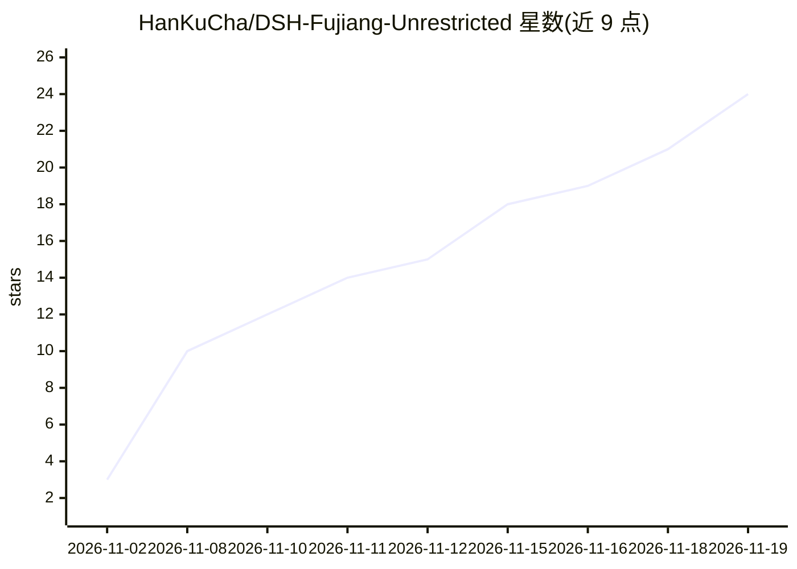

# HanKuCha/DSH-Fujiang-Unrestricted

⭐ 24 · JavaScript · MIT · 推送 2026-11-18 · [GitHub](https://github.com/HanKuCha/DSH-Fujiang-Unrestricted) · 个人维护 · 中文 README

**为 DSH Desktop 用户提供富江人格预设与随包技能的一键安装器**

面向 DeepSeek Harness Desktop（DSH）与 DSHA 用户的插件安装器：安装富江 0.20.13 人格预设、中文面板、167 条内置知识库与任务/漏洞报告管理，并提供技能面板按需安装 REA、AboutSecurity。Windows EXE 内嵌完整插件与知识库，依赖系统 .NET Framework 4.8，只写入 DSH_HOME，安装前备份 profile 与原插件目录，校验发布文件并拒绝降级；升级时通过 overlay 禁用旧人格插件入口避免重复注入。

## 筛选速览

| 维度 | 判定 | 备注 |
|---|---|---|
| AI 角色 | `ai-enhanced` | 去掉 AI 部分产品仍成立 |
| 许可风险 | `permissive` | MIT |
| 部署形态 | `desktop` | 安装包/桌面程序 |
| 模型依赖 | — | README 未给出锁定关系 |
| 硬件要求 | — | 无带数字的原话,不猜 |
| 安装摩擦 | `low` | 无编译、无系统依赖或容器化 |
| 成熟度 | — | 结构信号不足 |

## 能力要点

- Windows 一键 EXE 安装，内嵌完整插件与 167 条知识库，只改 DSH_HOME
- 提示词面板支持编辑、追加/替换模式与生效预览，旧默认文案自动备份
- 协作模块：模型调用工具前先补充可见回应再继续原调用
- DSHA 安卓包可通过插件管理导入本地 zip

## 适用场景

- 为 DSH Desktop 一键安装富江人格与随包知识库
- 在 DSH 中创建绑定会话的任务并跟踪阶段进度
- 按需安装和管理 REA、AboutSecurity 等技能

## 场景标签

 · 领域:AI 桌面工具/插件分发

## 证据(README 行号)

> L3: 富江 0.20.13 原版功能与可编辑人格，集成收到插话后先回应、再继续任务的协作模块。当前版本为 **1.4.3**，适用于 DeepSeek Harness Desktop 和 DSHA。
> L11: ## 功能

## 星数曲线

2026-11-02 3 → 2026-11-19 24（+21）

---
*卡片 v1 · prompt 1.4 · 生成 2026-11-18 · 置信度 high · 依据 README sha `6a8a2858a63d` · [字段定义](../../DATASET.md)*
