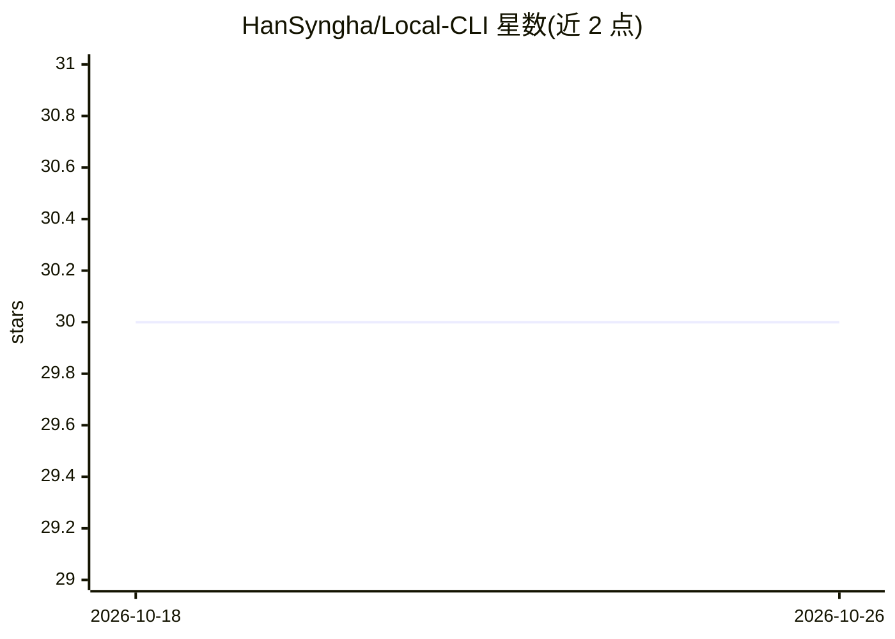

# HanSyngha/Local-CLI

⭐ 30 · TypeScript · MIT · 推送 2026-05-11 · [GitHub](https://github.com/HanSyngha/Local-CLI) · [官网](https://hansyngha.github.io/Local-CLI/) · 个人维护

**面向本地/企业内网 LLM 的 OpenAI 兼容 CLI 编码代理**

Node.js/TypeScript 编写的编码代理，CLI 与 Electron 双窗口桌面应用两种形态。接入任意 OpenAI 兼容 API（vLLM、Ollama、LM Studio、Azure OpenAI 等），以 Plan & Execute 架构分解任务为 TODO 步骤逐步执行，支持文件读写编辑、Plan/Execution 分模型选择、监督模式（文件修改需人工批准）、会话保存与上下文压缩。另含 Office 子代理（经 PowerShell/COM 生成 Word/Excel/PowerPoint）、无头 Chrome 网络研究子代理、Confluence/Jira 浏览器集成与视觉模型分析。Office 与浏览器自动化功能要求 Windows。

## 筛选速览

| 维度 | 判定 | 备注 |
|---|---|---|
| AI 角色 | `ai-native` | 本体是模型或模型工具 |
| 许可风险 | `permissive` | MIT |
| 部署形态 | `desktop` | 安装包/桌面程序 |
| 模型依赖 | local-ok | 支持本地模型 |
| 硬件要求 | — | 无带数字的原话,不猜 |
| 安装摩擦 | `low` | 无编译、无系统依赖或容器化 |
| 成熟度 | — | 结构信号不足 |

## 能力要点

- Plan & Execute 架构：任务分解为 TODO 步骤逐步执行，Plan/Execution 可选不同模型
- 监督模式：文件修改需显式批准，拒绝可附反馈
- Office 子代理生成 Word/Excel/PowerPoint 文档（增强 LLM→规划 LLM→执行→审查流程）
- CLI（npm）与 Electron 桌面应用（NSIS 安装包+自动更新）双形态，支持管道模式

## 适用场景

- 在内网/离线环境用自有 LLM 做代码修改与项目开发
- 让 AI 代理自动生成 Word/Excel/PowerPoint 文档
- 通过浏览器自动化操作 Jira/Confluence 与网页数据抓取

## 场景标签

`编码 Agent` `浏览器自动化` · 领域:效率与自动化

## 证据(README 行号)

> L11: **OpenAI-Compatible CLI Coding Agent for Local & On-Prem LLM Environments**
> L56: |**Autonomous Coding Agent**|Reads, searches, edits, and creates code files — not just chat.|

## 星数曲线

2026-10-18 30 → 2026-10-26 30（+0）

---
*卡片 v1 · prompt 1.4 · 生成 2026-10-26 · 置信度 high · 依据 README sha `bc4b089e058a` · [字段定义](../../DATASET.md)*
