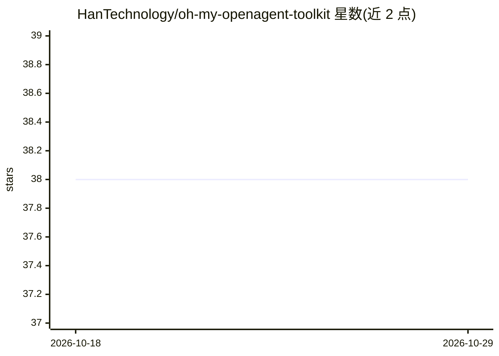

# HanTechnology/oh-my-openagent-toolkit

⭐ 38 · JavaScript · MIT · 推送 2026-06-05 · [GitHub](https://github.com/HanTechnology/oh-my-openagent-toolkit) · 组织维护

**oh-my-openagent 的 OpenCode 项目伴生工具包：路由与技能组织**

构建在 oh-my-openagent 之上的 OpenCode 伴生工具包（npm 包），为项目增加薄路由（六类请求分桶与包推荐）、45 个技能入口、工作区约定（workspace/{project-name}-{domain}）、治理参考文档，以及 init/migrate/update/validate/doctor CLI 命令。明确声明非官方上游、非 harness 替代、非第二控制平面；公开支持面收窄为 4 个 validated 工作流，其余标记为 guided 或 planned。附带 Impeccable v3.1.1 设计层与 73 份 DESIGN.md 参考快照（仅作视觉语言参考）。通过 npx 安装，源码可 clone 后以 npm test 与 validate 脚本验证。给使用 OpenCode 且 oh-my-openagent 的团队使用。

## 筛选速览

| 维度 | 判定 | 备注 |
|---|---|---|
| AI 角色 | `ai-ecosystem` | LLM/agent 周边工具 |
| 许可风险 | `permissive` | MIT |
| 部署形态 | `library` | 以包/库形式分发 |
| 模型依赖 | — | README 未给出锁定关系 |
| 硬件要求 | — | 无带数字的原话,不猜 |
| 安装摩擦 | `low` | 无编译、无系统依赖或容器化 |
| 成熟度 | — | 结构信号不足 |

## 能力要点

- 45 个顶级技能入口（42 核心 + 3 规划中），覆盖架构/UI/后端/系统/数据/安全/QA/部署
- CLI 提供 init/migrate/update/validate/doctor 命令，默认 dry-run 且迁移带守卫标记
- 支持分层治理：validated/guided/planned 三级，validated 仅 4 个工作流
- 导入 Impeccable v3.1.1 设计层与 73 份离线 DESIGN.md 参考快照

## 适用场景

- 在现有 OpenCode 项目上叠加路由与技能组织层
- 团队统一工作区目录与支持边界文档
- 为 UI 工作选取设计参考与润色命令

## 场景标签

`Agent 框架` · 领域:Agent 开发

## 证据(README 行号)

> L3: Project-local OpenCode bundle for teams that want a clearer operating layer on top of `oh-my-openagent`, without pre
> L7: `oh-my-openagent-toolkit` adds local routing, support framing, workspace conventions, package installation helpers, 
> L47: |Package CLI|Safe `init`, `migrate`, `update`, `validate`, and `doctor` commands for target projects.|`bin/omo-tool

## 星数曲线

2026-10-18 38 → 2026-10-29 38（+0）

---
*卡片 v1 · prompt 1.4 · 生成 2026-10-25 · 置信度 high · 依据 README sha `82773d84c178` · [字段定义](../../DATASET.md)*
