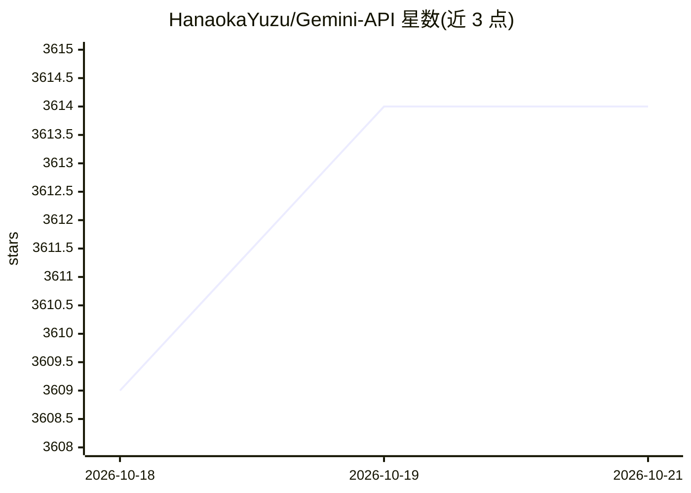

# HanaokaYuzu/Gemini-API

⭐ 3,614 · Python · AGPL-3.0 · 推送 2026-10-08 · [GitHub](https://github.com/HanaokaYuzu/Gemini-API) · [官网](https://pypi.org/project/gemini-webapi/) · 个人维护

**逆向工程的 Google Gemini 网页版异步 Python 客户端库**

对 Google Gemini 网页应用的逆向工程封装，以异步 Python 库形式提供：通过浏览器提取的 Cookie 认证，后台自动刷新 Cookie 以支持常驻服务。能力包括文本生成、图像/视频/音频生成、深度研究工作流、文件输入、多轮会话与历史读取/删除、流式输出、临时会话模式、动态模型发现与选择、经 Gems 应用系统提示。要求 Python 3.11+，附 CLI 工具，可选 browser-cookie3 从 Firefox 导入 Cookie。属非官方接口，依赖逆向协议，Cookie 时效受浏览器策略影响。

## 筛选速览

| 维度 | 判定 | 备注 |
|---|---|---|
| AI 角色 | `ai-ecosystem` | LLM/agent 周边工具 |
| 许可风险 | `viral` | AGPL-3.0 |
| 部署形态 | `library` | 以包/库形式分发 |
| 模型依赖 | — | README 未给出锁定关系 |
| 硬件要求 | — | 无带数字的原话,不猜 |
| 安装摩擦 | `low` | 无编译、无系统依赖或容器化 |
| 成熟度 | — | 结构信号不足 |

## 能力要点

- 文本/图像/视频/音频生成与流式输出
- 后台自动刷新 Cookie，适配常驻服务
- 动态发现账号可用模型，支持自定义模型头
- 多轮会话、历史读取/删除与 Gemini Gems 系统提示

## 适用场景

- 在 Python 程序中调用 Gemini 网页版完成生成任务
- 构建基于 Gemini 的聊天机器人并保持会话连续
- 容器化部署时通过卷持久化 Cookie 避免重复认证

## 场景标签

`图像生成` · 领域:内容生成

## 证据(README 行号)

> L23: A reverse-engineered asynchronous Python wrapper for the Google Gemini web app (formerly Bard).
> L35: - **CLI Tool** - Standalone command-line interface for quick interactions.

## 星数曲线

2026-10-18 3,609 → 2026-10-21 3,614（+5）

---
*卡片 v1 · prompt 1.4 · 生成 2026-10-20 · 置信度 high · 依据 README sha `919e1f63b0ef` · [字段定义](../../DATASET.md)*
