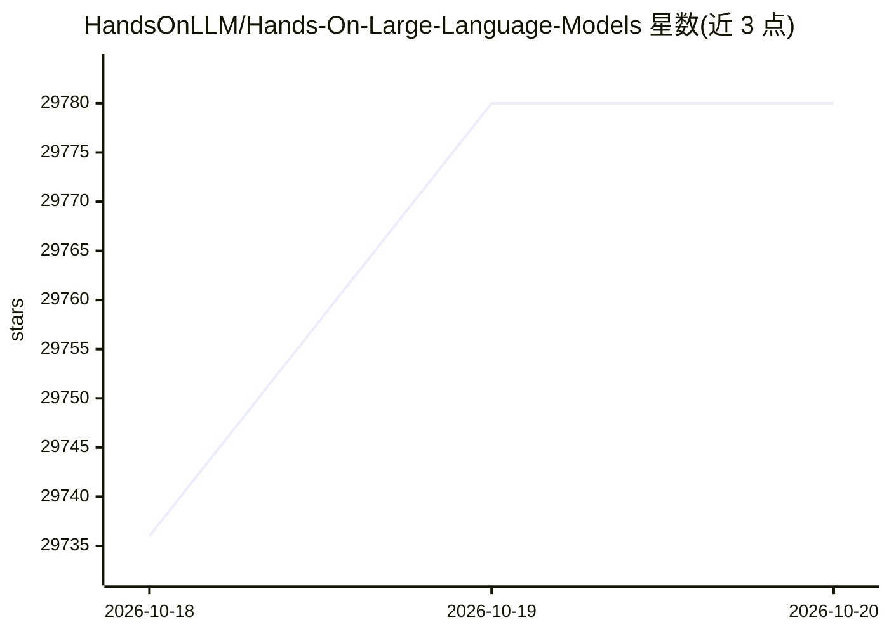

# HandsOnLLM/Hands-On-Large-Language-Models

⭐ 29,780 · Jupyter Notebook · Apache-2.0 · 推送 2026-04-24 · [GitHub](https://github.com/HandsOnLLM/Hands-On-Large-Language-Models) · [官网](https://www.llm-book.com/) · 个人维护

**O'Reilly《Hands-On Large Language Models》图书代码仓库**

存放 Jay Alammar 与 Maarten Grootendez 所著《Hands-On Large Language Models》全书示例代码，按书中章节组织，配合近 300 幅自绘图示讲解 LLM 的实践工具与概念。仓库还收录补充内容（Mamba、量化、稳定扩散、MoE、推理 LLM、DeepSeek-R1 等可视化指南），并提供书籍的 BibTeX 引用条目。购书渠道覆盖 Amazon、O'Reilly、Kindle、Barnes and Noble 等平台。

## 筛选速览

| 维度 | 判定 | 备注 |
|---|---|---|
| AI 角色 | `ai-knowledge` | 知识聚合/清单类 |
| 许可风险 | `permissive` | Apache-2.0 |
| 部署形态 | `None` |  |
| 模型依赖 | — | README 未给出锁定关系 |
| 硬件要求 | — | 无带数字的原话,不猜 |
| 安装摩擦 | `low` | 无编译、无系统依赖或容器化 |
| 成熟度 | — | 结构信号不足 |

## 动量与使用信号

- 维护:`maintenance` — 距上次 push 176.9 天,年发版 0,11 位贡献者
- 涨星:近 1 天 **+136**(自 20261016 起算)

## 能力要点

- 收录全书各章节示例代码
- 提供 Mamba/量化/MoE/推理 LLM/DeepSeek-R1 等补充可视化指南
- 提供 BibTeX 学术引用条目
- 书籍在 Amazon、O'Reilly、Kindle 等多平台发售

## 适用场景

- 跟随图书章节运行代码学习 LLM 概念
- 科研写作中引用该书
- 阅读补充可视化指南深入了解新技术

## 场景标签

`教程课程` · 领域:学习与行业

## 证据(README 行号)

> L3: Welcome! In this repository you will find the code for all examples throughout the book Hands-On Large Language Mode
> L7: Through the visually educational nature of this book and with **almost 300 custom made figures**, learn the practica
> L51: **A Visual Guide to Mixture of Experts** | **A Visual Guide to Reasoning LLMs** | **The Illustrated DeepSeek-R1**

## 星数曲线

2026-10-18 29,736 → 2026-10-20 29,780（+44）

---
*卡片 v1 · prompt 1.4 · 生成 2026-10-18 · 置信度 high · 依据 README sha `05faf3cd4e0a` · [字段定义](../../DATASET.md)*
