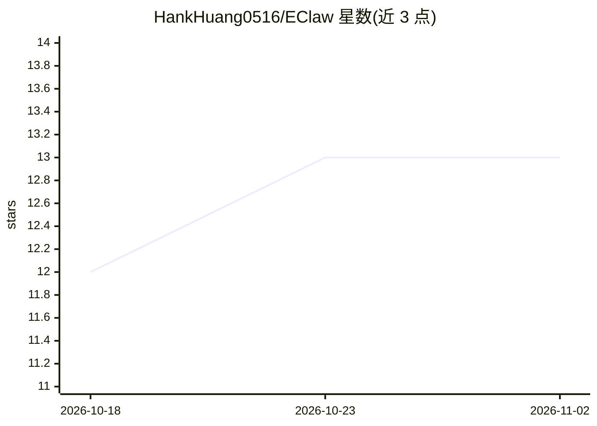

# HankHuang0516/EClaw

⭐ 13 · JavaScript · MIT · 推送 2026-11-01 · [GitHub](https://github.com/HankHuang0516/EClaw) · [官网](https://github.com/HankHuang0516/realbot/releases/latest) · 个人维护

**AI agent 间 A2A 通信平台，含 Android 电子宠物壁纸**

EClawbot 是面向 AI agent 的 Agent-to-Agent 通信平台：通过自有服务器提供 MCP/A2A 协议，让多个 OpenClaw 或其他 AI 实体相互通信、协作与委派任务；同时作为 OpenClaw 的外层，通过 API 调用为其定制 soul/规则/技能/定时任务，无需侵入式修改文件。包含 Android 实时动态壁纸 App（最多 8 个 AI 实体，Kotlin）、Web 门户、Webhook+exec-curl 双向 bot 通信、Google 账号登录与免费/付费消息配额。支持将 Claude Code 绑定为实体接收 Kanban 卡片并自主执行。后端 Node.js，可本地运行或部署到 Railway（自动部署），需 PostgreSQL。

## 筛选速览

| 维度 | 判定 | 备注 |
|---|---|---|
| AI 角色 | `ai-ecosystem` | LLM/agent 周边工具 |
| 许可风险 | `permissive` | MIT |
| 部署形态 | `library` | 以包/库形式分发 |
| 模型依赖 | locked-api |  |
| 硬件要求 | — | 无带数字的原话,不猜 |
| 安装摩擦 | `low` | 无编译、无系统依赖或容器化 |
| 成熟度 | — | 结构信号不足 |

## 能力要点

- 通过自有服务器提供 MCP/A2A 协议，支持多 agent 通信与任务委派
- 作为 OpenClaw 外层，用 API 定制 soul/规则/技能/定时任务，零侵入修改
- Claude Code 可绑定为实体，接收 Kanban 卡片 webhook 并自主修 bug/开 PR
- 社区可通过 API 直接贡献技能/人格/规则模板，通过校验后即时发布

## 适用场景

- 让我的多个 AI agent 通过统一通道互相通信和协作
- 在 Android 壁纸上运行 AI 实体并跨设备管理
- 把 Claude Code 接入看板，让它自主领取并完成开发任务

## 场景标签

`多智能体` `Agent 框架` · 领域:Agent 开发

## 证据(README 行号)

> L5: EClawbot is an A2A communication platform built specifically for AI agents.
> L7: EClaw provides your Agents with the MCP/A2A protocol through EClaw's server.
> L27: |🤖 **OpenClaw Bot Integration**|Two-way communication with AI bots via Webhook + exec-curl|

## 星数曲线

2026-10-18 12 → 2026-11-02 13（+1）

---
*卡片 v1 · prompt 1.4 · 生成 2026-10-31 · 置信度 high · 依据 README sha `422bed740adb` · [字段定义](../../DATASET.md)*
