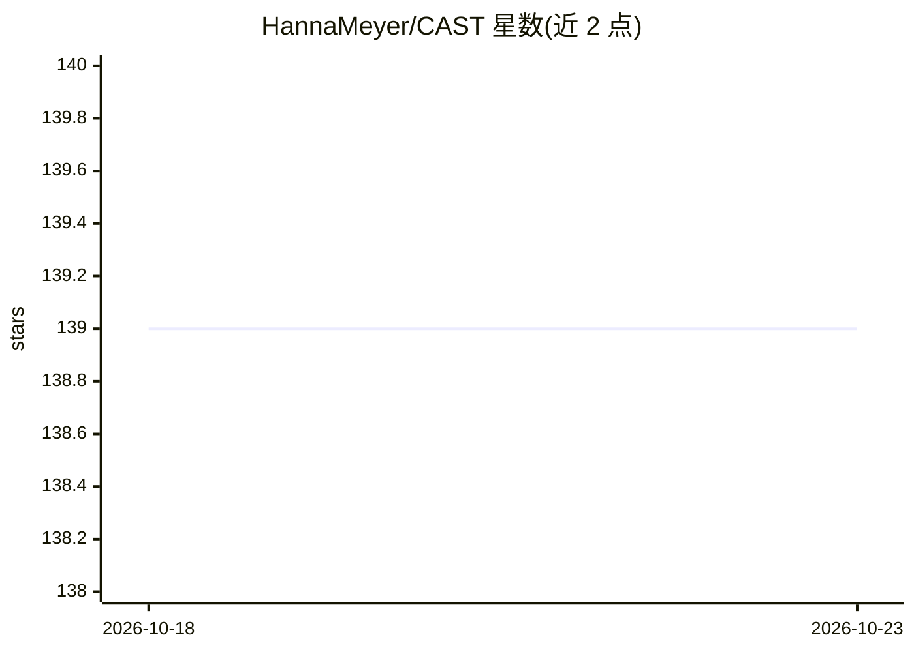

# HannaMeyer/CAST

⭐ 139 · R · 推送 2026-09-24 · [GitHub](https://github.com/HannaMeyer/CAST) · [官网](https://hannameyer.github.io/CAST/) · 组织维护

**R 包：为时空数据的 caret 建模提供空间交叉验证与变量选择**

R 语言包，为机器学习框架 caret 补充空间与时空建模支持：实现前向特征选择以降低空间过拟合、最近邻距离匹配（LOO/k 折）交叉验证用于地图精度估计、以及预测模型适用区域（AOA）估计与局部训练密度评估。面向从事空间预测制图的环境/生态建模研究者，附教程视频与 Springer 书章节等科学文档。本仓库为开发版，另有 CRAN 发布版。

## 筛选速览

| 维度 | 判定 | 备注 |
|---|---|---|
| AI 角色 | `ai-ecosystem` | LLM/agent 周边工具 |
| 许可风险 | `none` | — |
| 部署形态 | `None` |  |
| 模型依赖 | — | README 未给出锁定关系 |
| 硬件要求 | — | 无带数字的原话,不猜 |
| 安装摩擦 | `low` | 无编译、无系统依赖或容器化 |
| 成熟度 | — | 结构信号不足 |

## 能力要点

- 面向空间性能的前向特征选择，降低空间过拟合
- 最近邻距离匹配交叉验证（NNDM LOO 与 kNNDM）用于地图验证
- 预测模型适用区域（Area of Applicability）估计
- 检测模型学到捷径而非真实关系（Clever Hans 效应）的功能定位

## 适用场景

- 空间预测制图前选择对空间性能有贡献的预测变量
- 用空间交叉验证估计地图精度，避免随机 CV 高估
- 圈定模型可外推的适用区域，评估预测不确定性

## 场景标签

 · 领域:空间数据科学/环境建模

## 证据(README 行号)

> L9: Supporting functionality to run 'caret' with spatial or spatial-temporal data. 'caret' is a frequently used package 
> L75: CAST is designed to help you detect this. It allows you to test for the spatial transferability of your model (via 

## 星数曲线

2026-10-18 139 → 2026-10-23 139（+0）

---
*卡片 v1 · prompt 1.4 · 生成 2026-10-22 · 置信度 high · 依据 README sha `eb44ac2464c8` · [字段定义](../../DATASET.md)*
