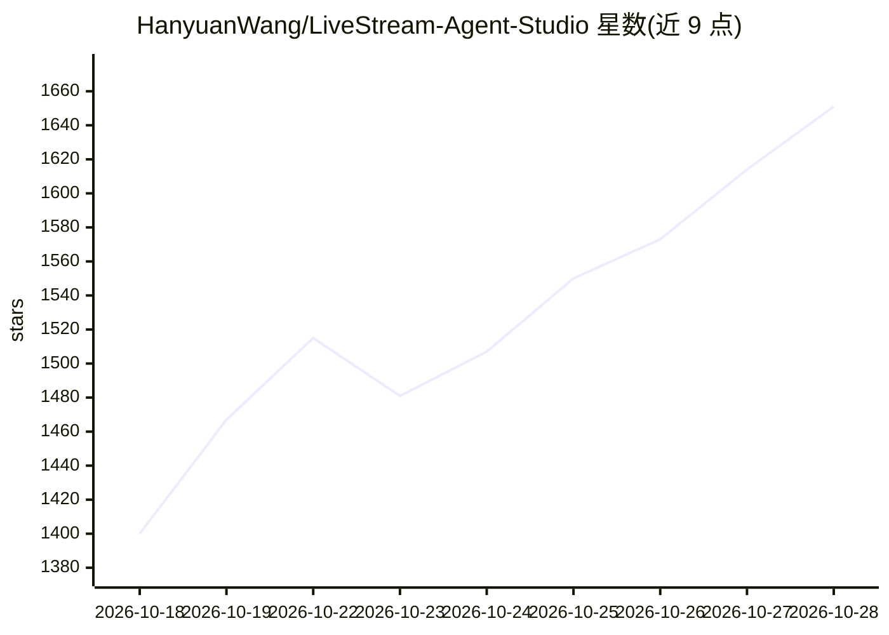

# HanyuanWang/LiveStream-Agent-Studio

⭐ 1,691 · Python · MIT · 推送 2026-08-24 · [GitHub](https://github.com/HanyuanWang/LiveStream-Agent-Studio) · 个人维护 · 中文 README

**面向抖音直播电商团队的 Windows 本地 AI Agent 工作台**

面向直播电商运营、投放、内容与复盘团队的 Windows 本地优先 AI 工作台，包含四个 Agent：主播发现（读取用户账号可见的蝉妈妈榜单/主播页生成达人拆解）、直播拆解（云端转写输出带秒级时间戳的 Excel 逐字稿）、直播复盘（对齐逐字稿与分钟级流量数据输出 Excel/Word 报告）、短视频编导（基于参考链接生成原创脚本与分镜）。模型与转写使用用户自备的阿里云百炼 DashScope API Key 和私有 OSS，转写音频临时上传 OSS。以 Releases ZIP 包形式分发，EXE 启动后经本地服务在浏览器访问；首个公开版本，未商业签名。

## 筛选速览

| 维度 | 判定 | 备注 |
|---|---|---|
| AI 角色 | `ai-native` | 本体是模型或模型工具 |
| 许可风险 | `permissive` | MIT |
| 部署形态 | `desktop` | 安装包/桌面程序 |
| 模型依赖 | — | README 未给出锁定关系 |
| 硬件要求 | — | 无带数字的原话,不猜 |
| 安装摩擦 | `medium` | 含编译或系统依赖之一 |
| 成熟度 | `idea` | |

## 能力要点

- 四个 Agent 覆盖主播发现、直播拆解、复盘与短视频编导
- 逐字稿与分钟级流量数据对齐的话术-流量复盘分析
- 用户自备 DashScope API Key 与私有 OSS，密钥存于本地 .env
- 提供 SHA256 校验的 Windows x64 发布包

## 适用场景

- 直播运营团队对直播录屏做逐字稿拆解与流量复盘
- 投放团队批量研究候选主播并生成达人拆解报告
- 内容团队基于参考短视频生成原创口播脚本与分镜

## 场景标签

`语音识别` `AI 写作` · 领域:内容生成

## 证据(README 行号)

> L42: 将完整直播视频转化为带秒级时间戳的结构化逐字稿，自动完成音频提取、云端转写和内容整理，并输出可继续分析的 Excel 文件。
> L54: 根据用户提供的参考短视频链接提取真实逐字稿，在保留内容逻辑而非复制原文的前提下，生成原创口播脚本、内容结构、分镜与拍摄建议。
> L136: 1. 自己的阿里云百炼 DashScope API Key。

## 星数曲线

2026-10-18 1,400 → 2026-10-28 1,651（+251）

---
*卡片 v1 · prompt 1.4 · 生成 2026-10-21 · 置信度 high · 依据 README sha `9d42463027b9` · [字段定义](../../DATASET.md)*
