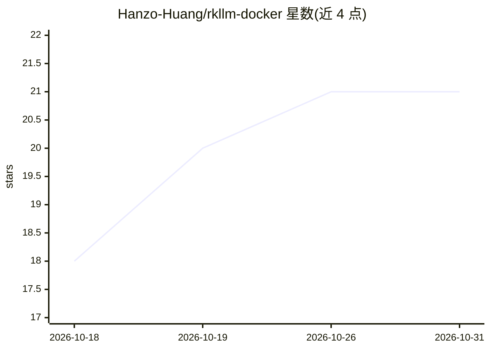

# Hanzo-Huang/rkllm-docker

⭐ 21 · Python · 推送 2026-10-23 · [GitHub](https://github.com/Hanzo-Huang/rkllm-docker) · 个人维护

**在 Rockchip NPU 上用 Docker 一条命令运行 RKLLM 模型的个人测试床**

面向 RK3576/RK3588 ARM64 设备的 Docker 镜像集合：把 RKLLM 运行时、RKNN Toolkit Lite、设备初始化与 FastAPI 服务打包进 linux/arm64 镜像，运行预转换的 .rkllm LLM/VLM 模型，通过 OpenAI 兼容与 Ollama 兼容 HTTP API 提供服务，支持流式输出与终端交互聊天。模型转换需先用 Rockchip RKLLM 工具链完成。作者声明这是个人测试项目而非稳定发布，预期存在缺陷与破坏性变更；镜像不支持 x86-64/macOS/Windows 主机的 NPU 推理。

## 筛选速览

| 维度 | 判定 | 备注 |
|---|---|---|
| AI 角色 | `ai-ecosystem` | LLM/agent 周边工具 |
| 许可风险 | `none` | — |
| 部署形态 | `self-host` | docker 或自建部署 |
| 模型依赖 | local-ok | 支持本地模型 |
| 硬件要求 | — | 无带数字的原话,不猜 |
| 安装摩擦 | `low` | 无编译、无系统依赖或容器化 |
| 成熟度 | `idea` | |

## 能力要点

- RK3576/RK3588 两平台多模型多量化档位的预构建镜像
- OpenAI 兼容与 Ollama 兼容两套 HTTP API，支持流式输出
- 模型免装镜像支持挂载自有 .rkllm/.rknn 文件运行自定义模型
- thinking 输出分离、SHA-256 校验与 RK3576 基准数据

## 适用场景

- 在 RK3576/RK3588 开发板上一条 Docker 命令跑本地 LLM/VLM 推理
- 对比不同模型与量化方案在 Rockchip NPU 上的表现
- 用 OpenAI/Ollama 兼容接口把板端模型接入现有客户端

## 场景标签

`推理引擎` · 领域:训练与推理

## 证据(README 行号)

> L9: RKLLM Docker packages the Rockchip RKLLM runtime, RKNN Toolkit Lite, device setup, and a FastAPI server into `linux/
> L28: - LLM images with OpenAI-compatible and Ollama-compatible APIs

## 星数曲线

2026-10-18 18 → 2026-10-31 21（+3）

---
*卡片 v1 · prompt 1.4 · 生成 2026-10-28 · 置信度 high · 依据 README sha `8b08d2870d22` · [字段定义](../../DATASET.md)*
