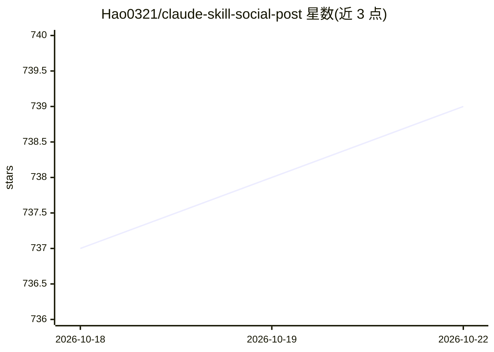

# Hao0321/claude-skill-social-post

⭐ 739 · JavaScript · MIT · 推送 2026-10-15 · [GitHub](https://github.com/Hao0321/claude-skill-social-post) · [官网](https://www.facebook.com/lo.jain.hao) · 个人维护 · 中文 README

**学习个人声线并跨平台发布/管理社群贴文的 Claude Code 技能**

可安装到 Codex 或 Claude Code 的社群内容 Skill，另提供精简 ChatGPT Chat 版。以六个 Mode 组织流程：规划内容日历、从本机样本学习个人声线、撰稿并经确认后发布、记录成效到本机 JSONL、跨平台模式比较，以及 P5 以已登录 Chrome 受控扫描与管理 FB／IG／Threads 指定留言（不串 Meta API、不导出 Cookie）。写作契约冻结声线版本，资料更新需作者审核；私人数据全部留在本机，公开 repo 只含匿名规则与 fictional 示例。需 Python 3.10+，工作台仅监听本机。

## 筛选速览

| 维度 | 判定 | 备注 |
|---|---|---|
| AI 角色 | `ai-native` | 本体是模型或模型工具 |
| 许可风险 | `permissive` | MIT |
| 部署形态 | `None` |  |
| 模型依赖 | — | README 未给出锁定关系 |
| 硬件要求 | — | 无带数字的原话,不猜 |
| 安装摩擦 | `low` | 无编译、无系统依赖或容器化 |
| 成熟度 | `idea` | |

## 能力要点

- 六个 Mode：规划／学声线／撰稿发布／记录成效／模式比较／Chrome 受控留言操作
- 私人写作契约冻结声线与 F 写法版本，来源漂移与过期版本会被拒绝
- P5 不串 Meta API、不导出 Cookie，送出开关默认关闭，真实送出仅限单次 canary
- 成效以结构化 JSONL 保存于本机，公开 repo 只含匿名规则与 fictional 示例

## 适用场景

- 用 AI 按我个人声线撰写并发布 FB／IG／Threads／X 贴文
- 以 14 天内容日历规划跨平台发文与实验
- 在本机记录与分析各平台贴文成效并比较模式
- 通过已登录 Chrome 草拟与核准社群留言回复

## 场景标签

`AI 写作` `浏览器自动化` `数据分析` · 领域:效率与自动化

## 证据(README 行号)

> L3: 一個可安裝到 Codex 或 Claude Code 的社群內容 Skill；另提供精簡的 ChatGPT Chat 版。可學習本機聲線、規劃內容、撰寫平台化貼文、經確認後發布，以已登入 Chrome 受控管理 FB／IG／Thre
> L122: |P2 Draft／Publish|撰稿；當輪確認後才發布|
> L125: |P5 Comment Ops|以 Chrome 受控掃描、草擬與核准；live 回覆需另經 canary 解鎖|

## 星数曲线

2026-10-18 737 → 2026-10-22 739（+2）

---
*卡片 v1 · prompt 1.4 · 生成 2026-10-21 · 置信度 high · 依据 README sha `c438cc0fff7c` · [字段定义](../../DATASET.md)*
