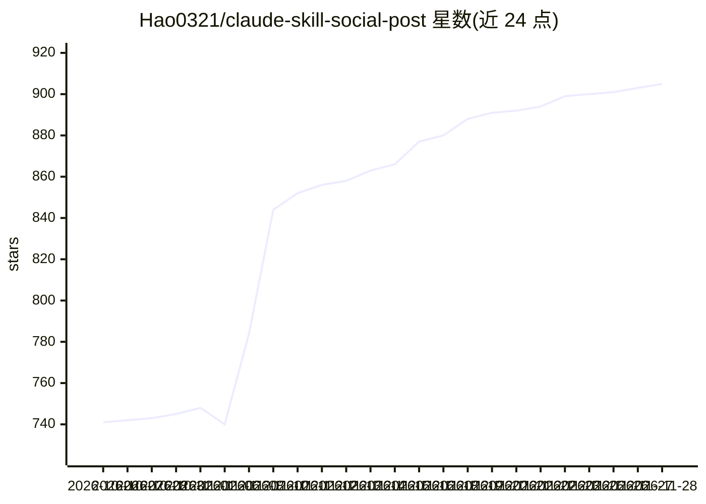

# Hao0321/claude-skill-social-post

⭐ 905 · JavaScript · MIT · 推送 2026-11-23 · [GitHub](https://github.com/Hao0321/claude-skill-social-post) · [官网](https://www.facebook.com/lo.jain.hao) · 个人维护 · 中文 README

**给社群经营者用 Claude Code/Codex 自动撰写与发布社群贴文的 Skill**

一个可安装到 Codex 或 Claude Code 的社群内容 Skill，另提供精简 ChatGPT Chat 版。功能分六个 Mode：内容规划、从授权样本学习个人声线、撰写平台化贴文（FB/IG/Threads/X）、经确认后发布、成效记录与跨平台规律比较，以及基于已登入 Chrome 的留言扫描与草拟。采用 MIT 开源，私人语气与成效数据只留本机 data/ 目录；live 送出开关默认关闭，需经 canary 验收解锁，真实自动回覆尚未完成三平台验收。需要 Python 3.10+ 运行本机脚本与工作台。

## 筛选速览

| 维度 | 判定 | 备注 |
|---|---|---|
| AI 角色 | `ai-native` | 本体是模型或模型工具 |
| 许可风险 | `permissive` | MIT |
| 部署形态 | `None` |  |
| 模型依赖 | — | README 未给出锁定关系 |
| 硬件要求 | — | 无带数字的原话,不猜 |
| 安装摩擦 | `low` | 无编译、无系统依赖或容器化 |
| 成熟度 | — | 结构信号不足 |

## 能力要点

- 六个 Mode 覆盖规划、声线学习、撰稿发布、成效记录、规律比较与留言操作
- Chrome 受控留言操作：扫描、草拟、核准，带 append-only ledger 与防重送机制
- 私人语气、贴文与账号数据只存本机，公开版仅含 schema、工具与 fictional 示例
- 本地工作台（localhost:8766）提供五平台×图文/影片十分区学习界面

## 适用场景

- 让 Claude Code 依个人声线撰写 FB/IG/Threads 贴文并排 14 天内容日历
- 本机记录各平台贴文成效并做同类型贴文比较
- 在已登入 Chrome 下受控扫描与管理社群留言草稿

## 场景标签

`AI 写作` · 领域:内容生成

## 证据(README 行号)

> L3: 一個可安裝到 Codex 或 Claude Code 的社群內容 Skill；另提供精簡的 ChatGPT Chat 版。可學習本機聲線、規劃內容、撰寫平台化貼文、經確認後發布，以已登入 Chrome 受控管理 FB／IG／Thre
> L138: |P2 Draft／Publish|撰稿；當輪確認後才發布|

## 星数曲线

2026-10-26 741 → 2026-11-28 905（+164）

---
*卡片 v1 · prompt 1.4 · 生成 2026-11-25 · 置信度 high · 依据 README sha `3af89d5f14a5` · [字段定义](../../DATASET.md)*
