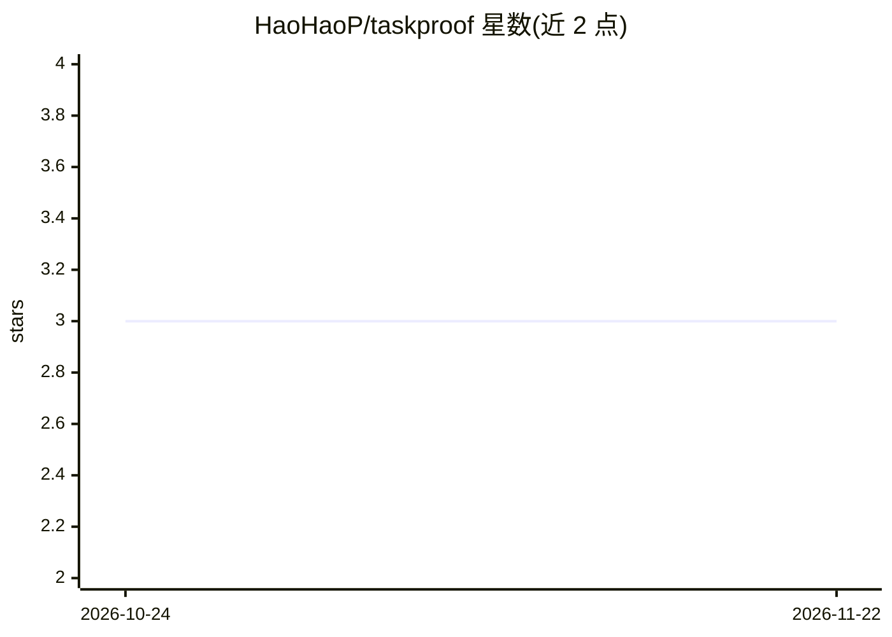

# HaoHaoP/taskproof

⭐ 3 · JavaScript · Apache-2.0 · 推送 2026-11-13 · [GitHub](https://github.com/HaoHaoP/taskproof) · [官网](https://taskproof.haohaop.com/) · 个人维护 · 中文 README

**AI 编码 agent 任务分发与独立验收审计工具**

面向使用 AI 编码 agent 的开发者：把任务卡分发给可插拔的 agent 适配器，agent 退出后由 taskproof 独立运行注册表中的验收命令，并将每一步写入只追加的审计账本；agent 自称完成不作为判定依据。纯标准库 Python（3.11+），SQLite 存状态，JSONL 审计流按月轮转，提供 CLI、浏览器看板、本地只读 REST API 与 Electron 桌面控制台（双语 zh-CN/en）。自身不含 LLM，不做任务规划。

## 筛选速览

| 维度 | 判定 | 备注 |
|---|---|---|
| AI 角色 | `ai-ecosystem` | LLM/agent 周边工具 |
| 许可风险 | `permissive` | Apache-2.0 |
| 部署形态 | `desktop` | 安装包/桌面程序 |
| 模型依赖 | — | README 未给出锁定关系 |
| 硬件要求 | — | 无带数字的原话,不猜 |
| 安装摩擦 | `low` | 无编译、无系统依赖或容器化 |
| 成熟度 | — | 结构信号不足 |

## 能力要点

- 独立验收机制：agent 自报不计数，由注册表验收命令裁定
- 受保护路径声明与 blocked/failed 两种终态区分
- 只追加审计账本：分发、验收、失败、重试全部记录
- 可插拔适配器：codex / claude / gemini / opencode / custom:<cmd>

## 适用场景

- 不让 agent 的'已完成'自报直接通过，用验收命令独立复核
- 多 agent 并行派发任务并按全局并发上限控制
- 事后查询某张任务卡的完整分发与验收记录
- 不写代码时通过桌面控制台管理任务卡

## 场景标签

`多智能体` `Agent 框架` · 领域:Agent 开发

## 证据(README 行号)

> L7: A conveyor belt for AI coding agents.
> L184: - **No LLM inside** — taskproof does not plan, decompose, or decide. Any agent
> L90: pluggable adapter (codex / claude / gemini / opencode, or `custom:<cmd>`), then

## 星数曲线

2026-10-24 3 → 2026-11-22 3（+0）

---
*卡片 v1 · prompt 1.4 · 生成 2026-11-22 · 置信度 mid · 依据 README sha `e8dccc5862ba` · [字段定义](../../DATASET.md)*
