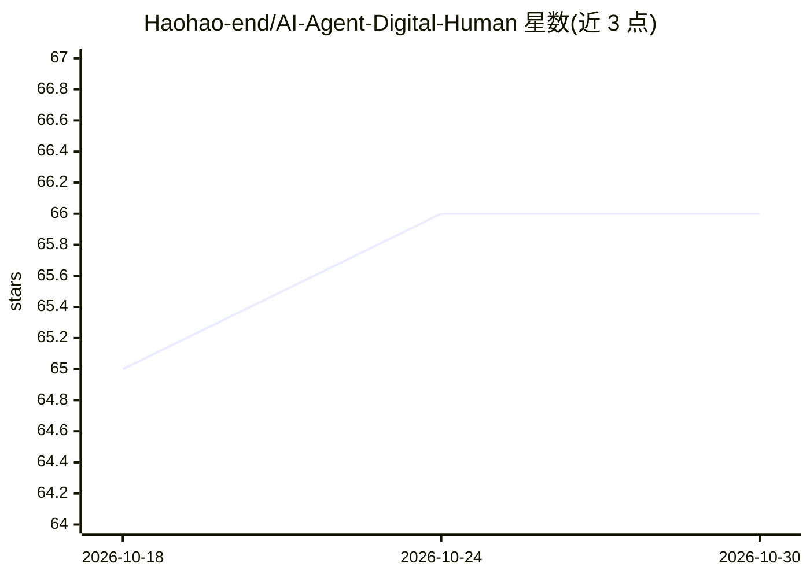

# Haohao-end/AI-Agent-Digital-Human

⭐ 66 · HTML · 推送 2026-01-10 · [GitHub](https://github.com/Haohao-end/AI-Agent-Digital-Human) · 个人维护

**虚拟秘书 Lisa：带实时数字人形象的对话 AI 应用**

面向终端用户的 AI 数字人虚拟秘书应用：前端用 Azure Speech Avatar SDK 通过 WebRTC 渲染实时动画形象并合成语音；后端 FastAPI + LangChain Agent 调用 OpenAI 兼容 LLM 生成回复，可自主决定是否调用 SerpAPI 联网搜索。包含情绪检测链，将用户输入分类为六种情绪并映射到 Azure SSML 语音风格；对话记忆存于 Redis（RedisChatMessageHistory），支持长对话摘要与用户属性提取。基础设施含 coturn TURN 服务器与 Docker 一键部署，需配置 OPENAI_API_KEY、SERPAPI_API_KEY 等环境变量及有效的 Azure Speech 资源。

## 筛选速览

| 维度 | 判定 | 备注 |
|---|---|---|
| AI 角色 | `ai-native` | 本体是模型或模型工具 |
| 许可风险 | `none` | — |
| 部署形态 | `self-host` | docker 或自建部署 |
| 模型依赖 | — | README 未给出锁定关系 |
| 硬件要求 | — | 无带数字的原话,不猜 |
| 安装摩擦 | `low` | 无编译、无系统依赖或容器化 |
| 成熟度 | — | 结构信号不足 |

## 能力要点

- WebRTC 实时数字人形象渲染与 SSML 情感语音合成
- LangChain 工具型 Agent 自主调用联网搜索
- 情绪检测映射六种语音风格，影响文本与语音表达
- Redis 长期对话记忆，自动摘要并提取用户属性

## 适用场景

- 部署一个带实时动画形象的语音对话助手
- 需要情绪感知与多语言多音色交互的虚拟秘书
- 在 Docker 中一键搭建数字人对话服务

## 场景标签

`语音 Agent` `语音合成` · 领域:对话与助手

## 证据(README 行号)

> L8: - Real-time conversational AI (LLM + LangChain Agents)
> L103: Handles user input, emotion detection, agent reasoning, and response generation.

## 星数曲线

2026-10-18 65 → 2026-10-30 66（+1）

---
*卡片 v1 · prompt 1.4 · 生成 2026-10-24 · 置信度 high · 依据 README sha `d95ef32d0d72` · [字段定义](../../DATASET.md)*
