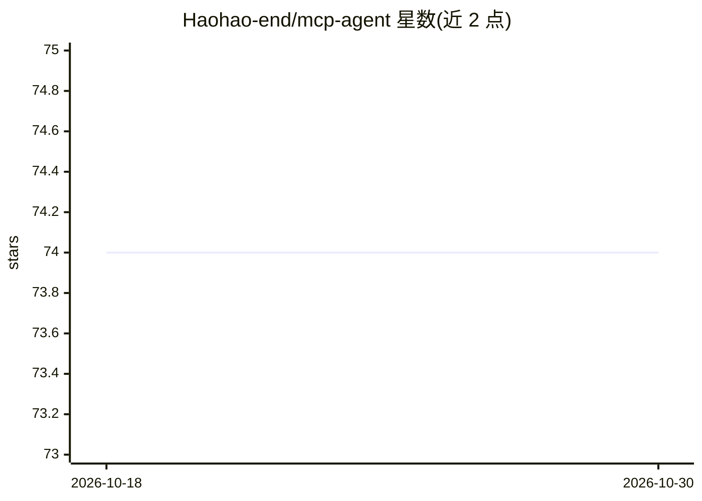

# Haohao-end/mcp-agent

⭐ 74 · Python · 推送 2026-07-04 · [GitHub](https://github.com/Haohao-end/mcp-agent) · 个人维护 · 中文 README

**MCP 协议的 Python 编排框架：让 LLM 调用工具与知识库**

基于 FastMCP 与 asyncio 的 MCP（Model Context Protocol）客户端-服务端实现：客户端负责服务端生命周期管理、工具发现、OpenAI 兼容的函数调用转换与多轮推理循环，经 StdIO 与独立 MCP 服务通信。内置两个示例服务：天气/网页搜索服务（WeatherAPI、You.com）和 RAG 知识库服务（LangChain 摄取 PDF/TXT、ChromaDB 持久化、MMR 检索、HuggingFace 向量）。LLM 接口用 OpenAI SDK，兼容 Qwen/DashScope，需配置 API key。

## 筛选速览

| 维度 | 判定 | 备注 |
|---|---|---|
| AI 角色 | `ai-ecosystem` | LLM/agent 周边工具 |
| 许可风险 | `none` | — |
| 部署形态 | `library` | 以包/库形式分发 |
| 模型依赖 | — | README 未给出锁定关系 |
| 硬件要求 | — | 无带数字的原话,不猜 |
| 安装摩擦 | `low` | 无编译、无系统依赖或容器化 |
| 成熟度 | — | 结构信号不足 |

## 能力要点

- 客户端编排：工具 schema 自动转换为 OpenAI 兼容函数调用，多轮推理循环
- StdIO 传输的 MCP 客户端-服务端解耦架构
- RAG 服务：LangChain + ChromaDB + MMR 多样性检索，支持 PDF/TXT
- 示例天气与 You.com 网页搜索工具服务

## 适用场景

- 学习或复用 MCP 协议的客户端-服务端实现
- 为 LLM 搭配外部工具与本地知识库的 Agent
- 参考 OpenAI 兼容接口下的工具调用编排

## 场景标签

`Agent 框架` `RAG` · 领域:Agent 开发

## 证据(README 行号)

> L5: The **MCP Agent Orchestrator** is a professional-grade Python implementation of the **Model Context Protocol (MCP)**
> L11: 1. **MCP Client**: Acts as the orchestrator. It manages the lifecycle of the MCP server, performs tool discovery, h

## 星数曲线

2026-10-18 74 → 2026-10-30 74（+0）

---
*卡片 v1 · prompt 1.4 · 生成 2026-10-24 · 置信度 mid · 依据 README sha `a979efece94f` · [字段定义](../../DATASET.md)*
