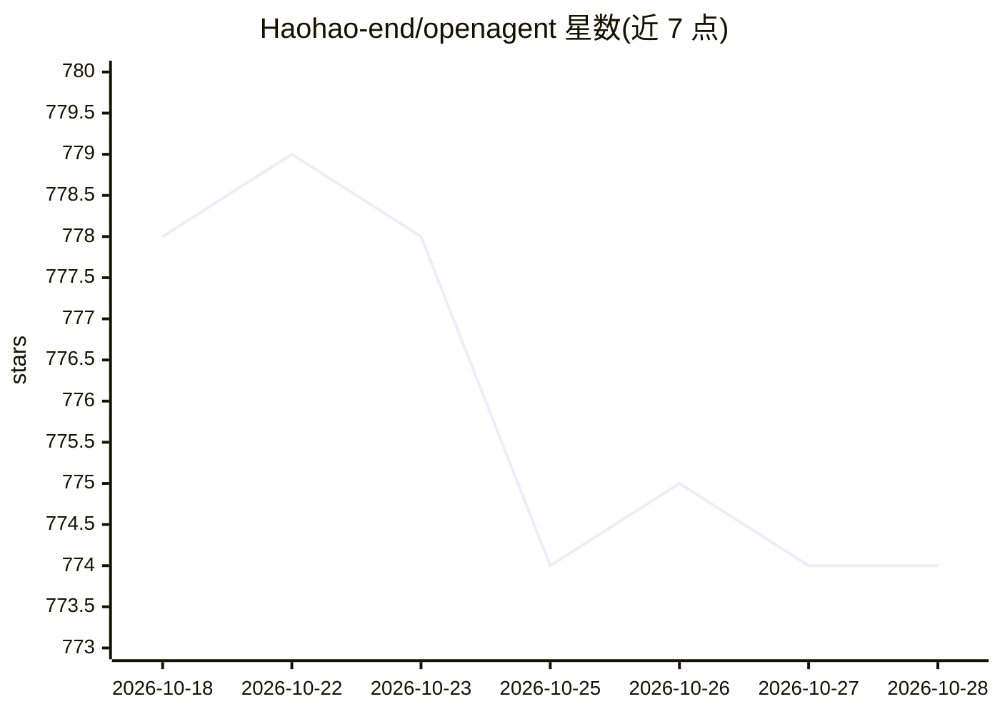

# Haohao-end/openagent

⭐ 774 · Python · MIT · 推送 2026-10-28 · [GitHub](https://github.com/Haohao-end/openagent) · [官网](https://openllm.cloud) · 个人维护 · 中文 README

**面向团队的全栈 AI 应用/智能体构建与编排平台**

端到端 AI agent 平台：Flask + LangChain/LangGraph 后端、Celery worker、Vue 3 前端。提供可视化工作流编排（LLM/工具/检索/代码/HTTP 等节点）、数据集与文档管理、RAG 检索（Weaviate/FAISS）、Deep Research 深度推理模式、A2A 委派的应用路由，以及通过 POST /api/openapi/chat 的 REST/SSE OpenAPI 交付。集成 OpenAI、DeepSeek、Ollama 等多家模型提供方。以 Docker Compose 部署，也可本地开发，要求 Python 3.11+ 与至少一个模型 API key。

## 筛选速览

| 维度 | 判定 | 备注 |
|---|---|---|
| AI 角色 | `ai-ecosystem` | LLM/agent 周边工具 |
| 许可风险 | `permissive` | MIT |
| 部署形态 | `self-host` | docker 或自建部署 |
| 模型依赖 | local-ok | 支持本地模型 |
| 硬件要求 | — | 无带数字的原话,不猜 |
| 安装摩擦 | `low` | 无编译、无系统依赖或容器化 |
| 成熟度 | — | 结构信号不足 |

## 能力要点

- 可视化工作流编辑器，含 LLM、工具调用、数据集检索、代码执行等节点
- Deep Research 模式分解复杂任务并协调多步执行
- 应用发布后经 /api/openapi/chat 提供 REST/SSE 调用
- 集成 OpenAI、DeepSeek、Ollama、智谱等多家模型提供方

## 适用场景

- 团队搭建、调试并发布面向业务的 AI 应用
- 用可视化工作流编排多步骤推理与检索流程
- 通过统一 OpenAPI 把已发布应用接入自己的系统

## 场景标签

`Agent 框架` `工作流自动化` `RAG` · 领域:Agent 开发

## 证据(README 行号)

> L30: OpenAgent is a full-stack platform for teams building AI applications rather than a single chat demo. The repositor
> L37: - Design workflows visually with nodes for LLMs, tool calls, dataset retrieval, code execution, HTTP requests, bran
> L40: - Expose published apps over REST and SSE through `POST /api/openapi/chat`.

## 星数曲线

2026-10-18 778 → 2026-10-28 774（-4）

---
*卡片 v1 · prompt 1.4 · 生成 2026-10-21 · 置信度 high · 依据 README sha `fcdaef424249` · [字段定义](../../DATASET.md)*
