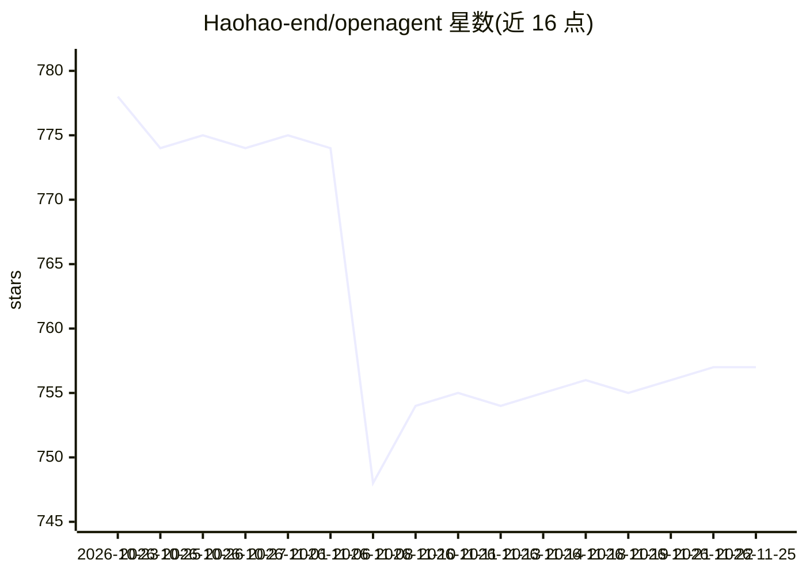

# Haohao-end/openagent

⭐ 757 · Python · MIT · 推送 2026-11-23 · [GitHub](https://github.com/Haohao-end/openagent) · [官网](https://openllm.cloud) · 个人维护 · 中文 README

**给团队构建、编排、发布 AI 应用的全栈平台**

OpenAgent 是一个全栈 AI 应用平台，包含 Flask 后端、Celery worker、Vue 3 前端与 Docker Compose 部署栈。核心能力包括：自然语言创建 AI 应用的工作区（草稿/发布/版本对比）、Deep Research 多步推理执行、可视化工作流编辑（LLM/工具/检索/代码/HTTP/分支等节点）、数据集与文档管理（Weaviate/FAISS 检索），以及通过 REST/SSE 的 OpenAPI 交付。运行需至少一个模型提供商 API key，全栈建议 8 GB+ 内存。提供中英文文档。

## 筛选速览

| 维度 | 判定 | 备注 |
|---|---|---|
| AI 角色 | `ai-ecosystem` | LLM/agent 周边工具 |
| 许可风险 | `permissive` | MIT |
| 部署形态 | `self-host` | docker 或自建部署 |
| 模型依赖 | local-ok | 支持本地模型 |
| 硬件要求 | — | 无带数字的原话,不猜 |
| 安装摩擦 | `low` | 无编译、无系统依赖或容器化 |
| 成熟度 | — | 结构信号不足 |

## 能力要点

- Deep Research 多步任务分解与能力协调执行
- 可视化工作流编辑器，节点覆盖 LLM、工具、检索、代码、HTTP、分支
- 数据集管理与 RAG 检索接入应用和工作流
- 发布应用经 POST /api/openapi/chat 提供 REST/SSE 接口

## 适用场景

- 团队构建和发布面向业务的 AI 应用
- 用可视化工作流编排 LLM、检索与工具调用
- 管理文档数据集并为应用接入知识检索
- 通过 OpenAPI 把 AI 应用交付给其他系统调用

## 场景标签

`Agent 框架` `工作流自动化` `RAG` · 领域:Agent 开发

## 证据(README 行号)

> L3:  An end-to-end AI agent platform for building, orchestrating, publishing, and operating AI applications.
> L31: OpenAgent is a full-stack platform for teams building AI applications rather than a single chat demo. The repositor
> L57: - AI framework and orchestration: LangChain, LangGraph, workflow orchestration, tool calling, A2A delegation, skill

## 星数曲线

2026-10-23 778 → 2026-11-25 757（-21）

---
*卡片 v1 · prompt 1.4 · 生成 2026-11-24 · 置信度 high · 依据 README sha `ab3c9dc68661` · [字段定义](../../DATASET.md)*
