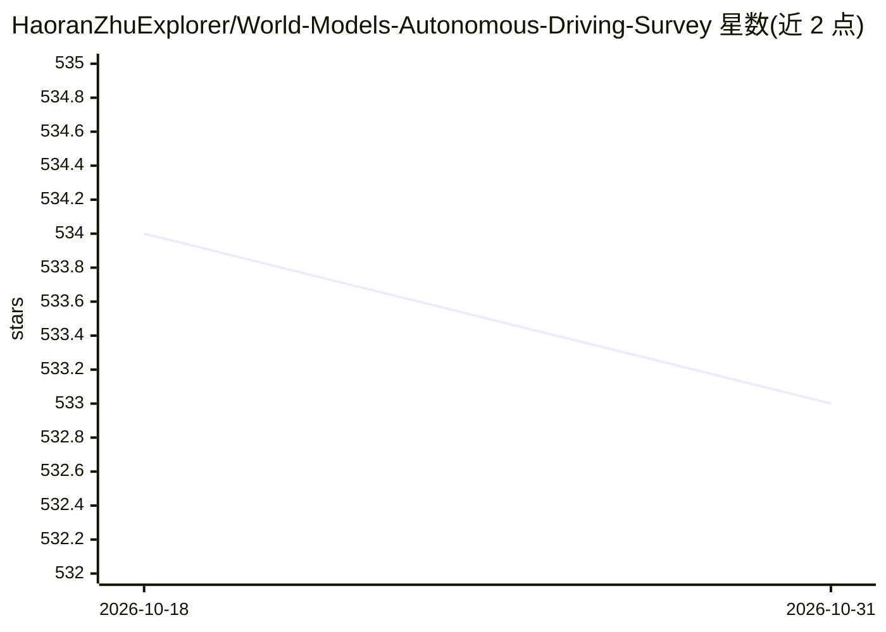

# HaoranZhuExplorer/World-Models-Autonomous-Driving-Survey

⭐ 533 · 推送 2025-12-23 · [GitHub](https://github.com/HaoranZhuExplorer/World-Models-Autonomous-Driving-Survey) · 组织维护

**自动驾驶世界模型论文策展清单，按会议年份组织**

由 NYU Learning Systems Laboratory 成员维护的自动驾驶世界模型论文聚合清单：按 NeurIPS/ICCV/ICML/CVPR/ICLR/AAAI/RSS 等会议与年份（2025 至 2019 前）组织条目，每条标注生成式 AI、强化学习、占据预测、规划、预训练等主题标签，并链接 Paper/Code/Website。另收录研讨会与挑战赛、教程演讲、相关综述，并在公告区发布维护者自身的 AD-L-JEPA 预印本及代码仓库。清单无安装或运行内容，仅作文献导航。

## 筛选速览

| 维度 | 判定 | 备注 |
|---|---|---|
| AI 角色 | `ai-knowledge` | 知识聚合/清单类 |
| 许可风险 | `none` | — |
| 部署形态 | `None` |  |
| 模型依赖 | — | README 未给出锁定关系 |
| 硬件要求 | — | 无带数字的原话,不猜 |
| 安装摩擦 | `low` | 无编译、无系统依赖或容器化 |
| 成熟度 | — | 结构信号不足 |

## 能力要点

- 按会议与年份组织的自动驾驶世界模型论文清单
- 每条目标注主题标签（生成式 AI/RL/占据预测/规划等）并链接 Paper、Code、Website
- 附带研讨会/挑战赛、教程演讲与相关综述栏目
- 公告区发布维护团队的 AD-L-JEPA 预印本（arXiv:2501.04969）

## 适用场景

- 按会议和年份查找自动驾驶世界模型论文
- 跟踪该方向 2019 年至 2025 年的研究脉络
- 查找世界模型相关的挑战赛与教程视频

## 场景标签

`科研工具` `精选清单` · 领域:学习与行业

## 证据(README 行号)

> L1: # World-Models-Autonomous-Driving-Latest-Survey
> L2: A curated list of world model for autonmous driving. Keep updated.

## 星数曲线

2026-10-18 534 → 2026-10-31 533（-1）

---
*卡片 v1 · prompt 1.4 · 生成 2026-10-21 · 置信度 high · 依据 README sha `41b9ba6a86cb` · [字段定义](../../DATASET.md)*
