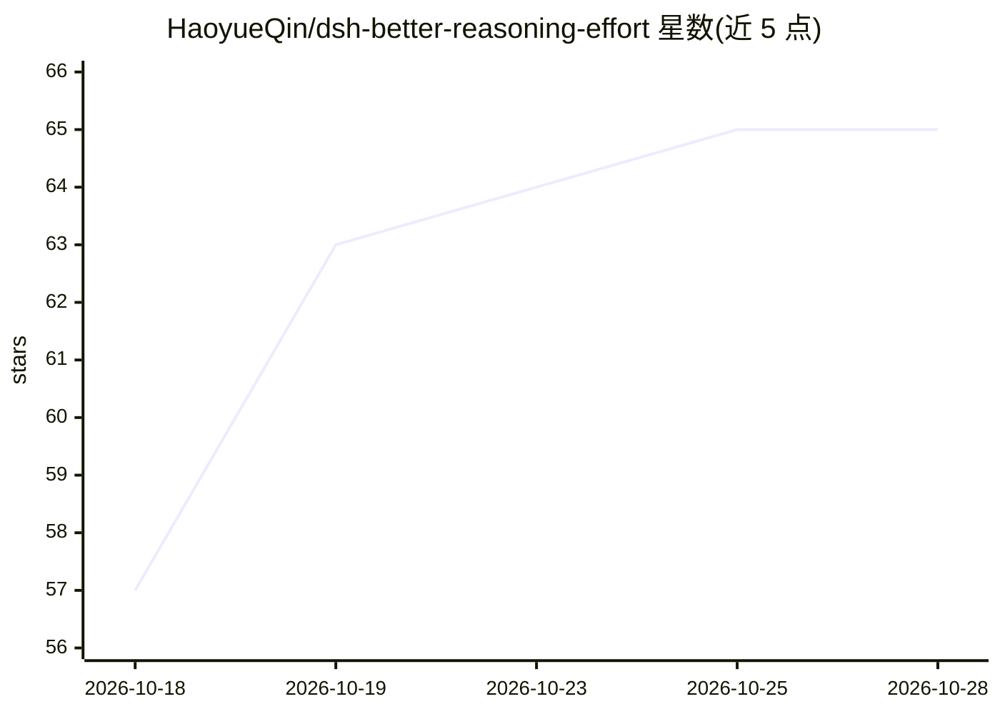

# HaoyueQin/dsh-better-reasoning-effort

⭐ 65 · TypeScript · MIT · 推送 2026-10-18 · [GitHub](https://github.com/HaoyueQin/dsh-better-reasoning-effort) · [官网](https://awesome-dsh-plugin.com/p/HaoyueQin/dsh-better-reasoning-effort) · 个人维护 · 中文 README

**DeepSeek Harness 插件：在官方页面编辑第三方模型的推理力度**

面向 DeepSeek Harness（0.1.5-alpha.1+）的 web 插件，为第三方模型补回官方界面未暴露的 reasoningEfforts 与输入模态声明编辑能力：在官方 Models 页模型卡内注入编辑块（含推理档位、模态、端点兼容），一键 Auto-adapt 依据内置 15 家厂商 65 条知识库与协议推断填充推荐值，另在官方模型菜单注入推理力度滑杆，支持每模型默认档位、请求头与 user-agent 改写。写入走官方 modelOverrides，注入失败时官方页面不受影响。限制包括依赖官方 DOM 结构、探测仅限回环主机、headers 凭据明文落盘。

## 筛选速览

| 维度 | 判定 | 备注 |
|---|---|---|
| AI 角色 | `ai-ecosystem` | LLM/agent 周边工具 |
| 许可风险 | `permissive` | MIT |
| 部署形态 | `desktop` | 安装包/桌面程序 |
| 模型依赖 | locked-api |  |
| 硬件要求 | — | 无带数字的原话,不猜 |
| 安装摩擦 | `low` | 无编译、无系统依赖或容器化 |
| 成熟度 | — | 结构信号不足 |

## 能力要点

- 官方 Models 页卡内编辑推理档位/输入模态，随卡内 Save 提交
- 内置 15 厂商 65 条知识库 + 线协议推断的 Auto-adapt 一键填充
- 官方模型菜单注入推理力度滑杆，带会话内记忆链与回滚
- 每模型默认档位、请求头编辑与按源 user-agent 覆写

## 适用场景

- 给第三方模型配置思考档位并在对话中调节
- 为手声明模型补上图像输入声明以支持附件
- 为不同网关端点微调推理参数的线上写法

## 场景标签

 · 领域:LLM 工具链/客户端插件

## 证据(README 行号)

> L13: Reasoning-effort **and input-modality** editing for **third-party models** in DeepSeek Harness, edited right inside
> L21: The `llm-pi-ai` adapter natively supports per-model `reasoningEfforts` and `input` declarations, but the official M
> L47: dsh plugin --profile web add dsh-better-reasoning-effort

## 星数曲线

2026-10-18 57 → 2026-10-28 65（+8）

---
*卡片 v1 · prompt 1.4 · 生成 2026-10-24 · 置信度 high · 依据 README sha `e61c2f0bdbe5` · [字段定义](../../DATASET.md)*
