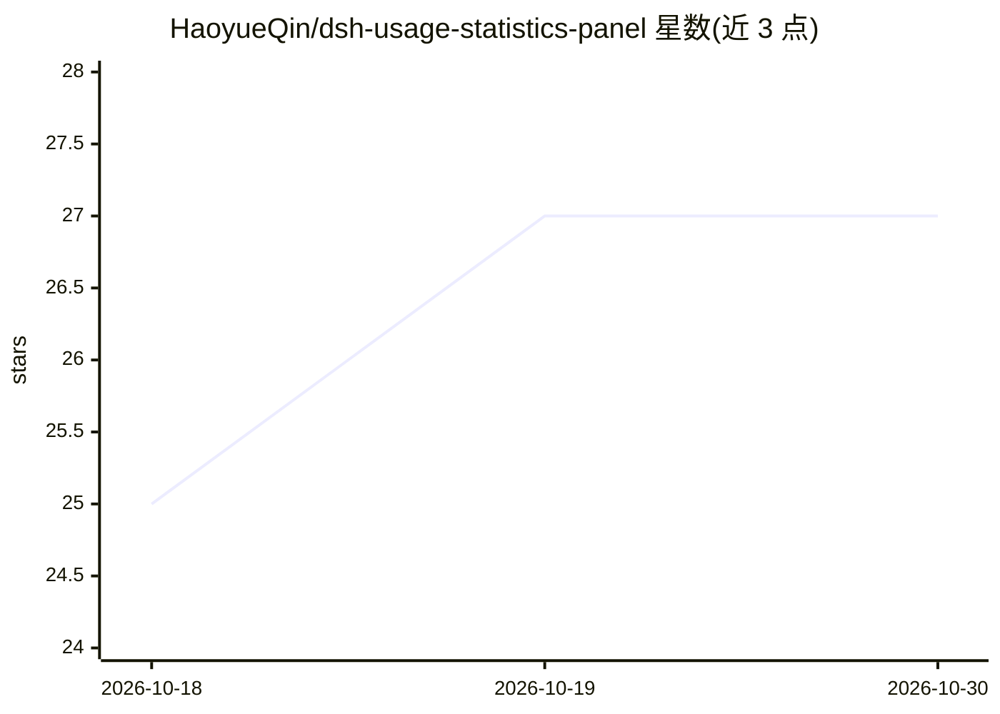

# HaoyueQin/dsh-usage-statistics-panel

⭐ 27 · TypeScript · MIT · 推送 2026-10-19 · [GitHub](https://github.com/HaoyueQin/dsh-usage-statistics-panel) · 个人维护 · 中文 README

**DSH 插件：Token 用量统计面板，含热力图与命中率曲线**

DeepSeek Harness（DSH）的 web 插件，作为插件页与左侧栏的独立页面提供用量统计：按天/按小时的 Token 趋势、GitHub 风格 52 周活跃热力图、缓存命中率曲线、按模型与按供应商的环形占比拆分，以及底部信息栏的精确命中率、Token 明细与流式吞吐速度增强。数据通过观测会话事件流、压缩摘要与 llm/stream 标题调用采集，本地持久化到 usage_history.json，无外部依赖；首次启用回扫既有会话日志。图表全部手绘 SVG，不依赖图表库。限制：不含联网搜索用量，会话标题无法回扫。

## 筛选速览

| 维度 | 判定 | 备注 |
|---|---|---|
| AI 角色 | `ai-ecosystem` | LLM/agent 周边工具 |
| 许可风险 | `permissive` | MIT |
| 部署形态 | `library` | 以包/库形式分发 |
| 模型依赖 | — | README 未给出锁定关系 |
| 硬件要求 | — | 无带数字的原话,不猜 |
| 安装摩擦 | `low` | 无编译、无系统依赖或容器化 |
| 成熟度 | — | 结构信号不足 |

## 能力要点

- 按天/按小时 Token 趋势、52 周活跃热力图、缓存命中率曲线
- 按模型（前 10）与按供应商（前 5）环形占比拆分
- 观测式采集：会话事件流 + 压缩摘要 + 标题调用，本地持久化无外部依赖
- 历史回扫既有会话日志，含子代理会话

## 适用场景

- 查看我在 DSH 中各模型/供应商的 Token 消耗分布
- 观察缓存命中率与流式吞吐速度
- 回顾一年内每日的使用活跃度

## 场景标签

`LLM 可观测性` · 领域:评测与运维

## 证据(README 行号)

> L16: DSH web 插件的用量统计面板：按天 / 按小时的 Token 趋势、GitHub 风格活跃热力图、缓存命中率曲线、按模型与按供应商两种用量拆分（环形占比图 + 明细列表），作为**插件**页中本插件的独立页面，并在左侧栏提供
> L66: 面板的数据采集是**观测式**的，共三处来源：会话事件流（`session/event`）中的 `assistant/message` 与 `assistant/chunk`（agent loop 的每次调用）、同一事件流中的 `

## 星数曲线

2026-10-18 25 → 2026-10-30 27（+2）

---
*卡片 v1 · prompt 1.4 · 生成 2026-10-26 · 置信度 high · 依据 README sha `8f16b146ed71` · [字段定义](../../DATASET.md)*
