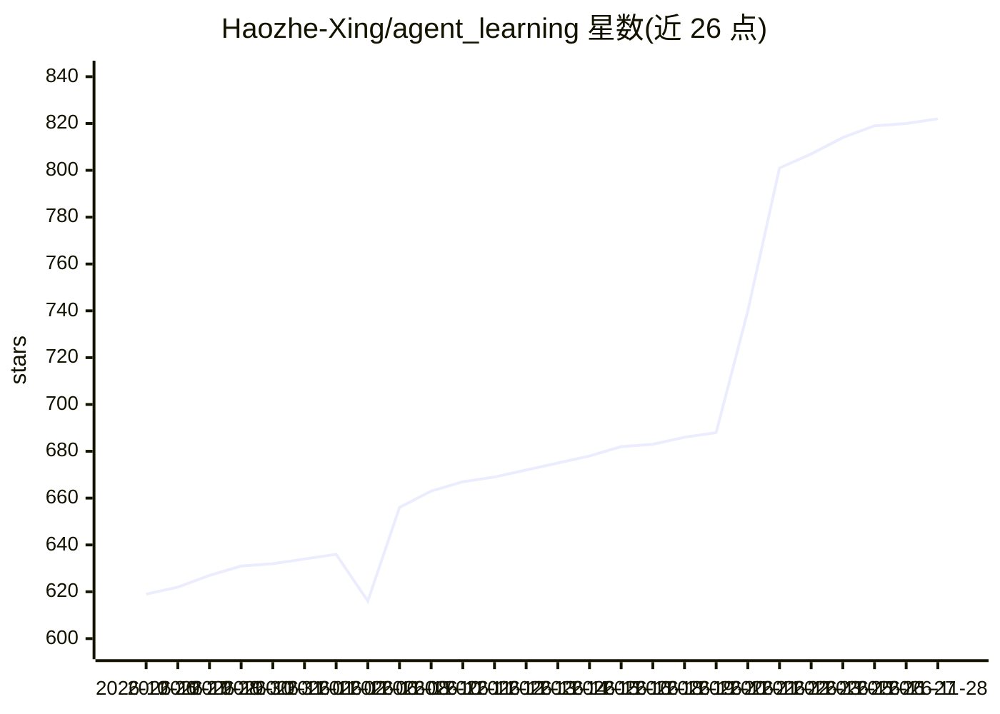

# Haozhe-Xing/agent_learning

⭐ 822 · HTML · MIT · 推送 2026-11-27 · [GitHub](https://github.com/Haozhe-Xing/agent_learning) · [官网](https://haozhe-xing.github.io/agent_learning/) · 个人维护 · 中文 README

**面向工程师的 AI Agent 开发系统教程（26 章，中英双语）**

以教科书形式组织的开源 AI Agent 学习仓库，覆盖 LLM 基础、工具调用、记忆、规划、RAG、上下文工程、Agentic RL、多智能体、评测、安全与部署，共 26 章，提供英文与中文两套 mdBook 版本及 330+ SVG 图与 5 个交互演示。附可运行的 reference-agent 教学基线实现（ReAct 循环、工具注册、记忆、注入防护、MCP server、FastAPI、离线测试），章节含 ReAct、MemGPT、GRPO 等论文解读。仓库声明这不是 awesome 清单或框架手册，而是结构化学习路径。

## 筛选速览

| 维度 | 判定 | 备注 |
|---|---|---|
| AI 角色 | `ai-knowledge` | 知识聚合/清单类 |
| 许可风险 | `permissive` | MIT |
| 部署形态 | `self-host` | docker 或自建部署 |
| 模型依赖 | — | README 未给出锁定关系 |
| 硬件要求 | — | 无带数字的原话,不猜 |
| 安装摩擦 | `low` | 无编译、无系统依赖或容器化 |
| 成熟度 | — | 结构信号不足 |

## 能力要点

- 26 章结构化教程，中英双语版本目录对齐
- 附可运行教学基线 Agent（工具、记忆、安全门、评测、MCP server）
- 330+ 原创 SVG 架构图与 5 个交互式演示
- 离线测试无需 API key 即可运行

## 适用场景

- 系统学习从 LLM API 调用到 Agent 生产部署的完整路径
- 在动手章节中阅读并改造可运行的参考 Agent 实现
- 查阅 ReAct、MemGPT、GRPO、MCP 等论文的工程解读

## 场景标签

`教程课程` · 领域:学习与行业

## 证据(README 行号)

> L22: `agent_learning` is an open-source AI Agent textbook and learning repository. It is designed for the gap between **
> L33: - **Paper-to-practice explanations** covering ReAct, Reflexion, MemGPT/Letta, GraphRAG, GRPO, MCP, A2A, and more.

## 星数曲线

2026-10-26 619 → 2026-11-28 822（+203）

---
*卡片 v1 · prompt 1.4 · 生成 2026-11-28 · 置信度 mid · 依据 README sha `e1c996e4ad9e` · [字段定义](../../DATASET.md)*
