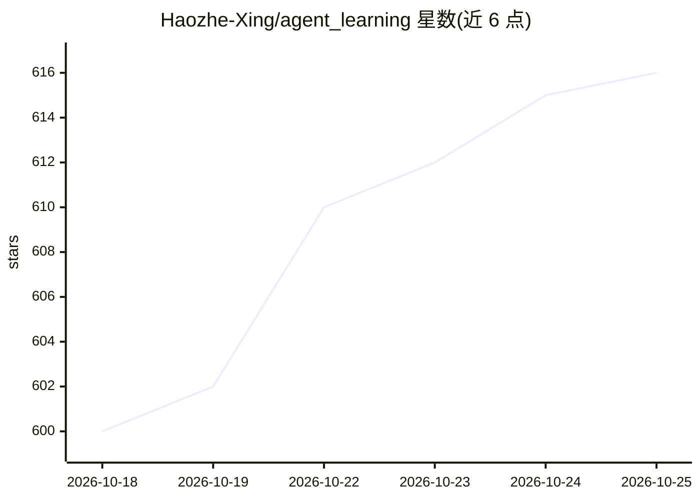

# Haozhe-Xing/agent_learning

⭐ 616 · HTML · MIT · 推送 2026-10-24 · [GitHub](https://github.com/Haozhe-Xing/agent_learning) · [官网](https://haozhe-xing.github.io/agent_learning/) · 个人维护 · 中文 README

**从零开始学 AI Agent 开发的双语教材仓库（23 章）**

面向从『会调 LLM API』到『能构建、评估、加固与部署 Agent 系统』的开发者的开源教材：23 章覆盖工具、记忆、规划、RAG、上下文工程、Agentic RL、多智能体、评估、安全与部署，中英双语各 188 页 Markdown，含 330+ SVG 图与 5 个交互演示。配套 reference-agent 可运行教学基线（ReAct 循环、离线 FakeProvider、MCP 服务、FastAPI、16 个无 API key 测试）。作者声明其为教学基线而非生产完整实现。

## 筛选速览

| 维度 | 判定 | 备注 |
|---|---|---|
| AI 角色 | `ai-knowledge` | 知识聚合/清单类 |
| 许可风险 | `permissive` | MIT |
| 部署形态 | `self-host` | docker 或自建部署 |
| 模型依赖 | — | README 未给出锁定关系 |
| 硬件要求 | — | 无带数字的原话,不猜 |
| 安装摩擦 | `low` | 无编译、无系统依赖或容器化 |
| 成熟度 | — | 结构信号不足 |

## 能力要点

- 23 章、中英双语各 188 页，覆盖基础到生产部署全链路
- 330+ 原创 SVG 图与 5 个交互演示
- reference-agent 可运行基线：ReAct 循环、安全门、MCP 服务器、FastAPI、16 个离线测试
- 论文到实践讲解（ReAct、Reflexion、MemGPT、GraphRAG、GRPO、MCP、A2A 等）

## 适用场景

- 系统学习 LLM Agent 开发并动手跑参考实现
- 理解 Agent 相关论文的机制与工程转化
- 中英双语对照学习 Agent 全链路知识

## 场景标签

`教程课程` · 领域:学习与行业

## 证据(README 行号)

> L22: `agent_learning` is an open-source AI Agent textbook and learning repository. It is designed for the gap between **
> L30: - **23 chapters** across foundations, core capabilities, frameworks, multi-agent systems, production, and capstone 

## 星数曲线

2026-10-18 600 → 2026-10-25 616（+16）

---
*卡片 v1 · prompt 1.4 · 生成 2026-10-21 · 置信度 mid · 依据 README sha `56dfcc841090` · [字段定义](../../DATASET.md)*
