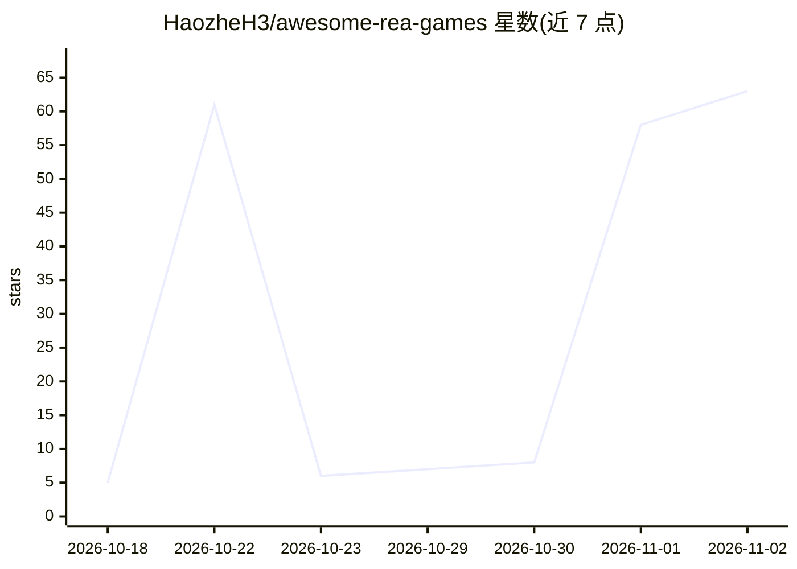

# HaozheH3/awesome-rea-games

⭐ 63 · 推送 2026-10-16 · [GitHub](https://github.com/HaozheH3/awesome-rea-games) · 个人维护

**游戏逆向工程与反编译项目策展清单（103 款游戏、140 个项目）**

按游戏组织的游戏反编译/重编译/移植/演示项目聚合清单：覆盖 103 款游戏、140 个项目、8 个分类（平台跳跃、RPG、动作射击、恐怖、竞速体育、策略模拟、街机休闲、可玩演示）。每款游戏配一张代表图、原版发行简介和对比表，区分源码重构、原生移植、静态重编译与可玩演示等不同项目类型。清单以 REA（reverse-engineer-anything）项目为起点并扩展收录其他逆向工程成果，面向玩家、开发者和游戏保存爱好者，开放社区贡献。

## 筛选速览

| 维度 | 判定 | 备注 |
|---|---|---|
| AI 角色 | `ai-knowledge` | 知识聚合/清单类 |
| 许可风险 | `none` | — |
| 部署形态 | `None` |  |
| 模型依赖 | — | README 未给出锁定关系 |
| 硬件要求 | — | 无带数字的原话,不猜 |
| 安装摩擦 | `low` | 无编译、无系统依赖或容器化 |
| 成熟度 | — | 结构信号不足 |

## 能力要点

- 收录 103 款游戏的 140 个反编译/移植/演示项目，分 8 类
- 每个条目区分源码重构、原生移植、静态重编译、可玩演示等类型
- 标注 REA 辅助（🔬）与可玩演示（▶）等标记体系

## 适用场景

- 按游戏查找对应的反编译或移植项目
- 了解某款游戏的源码重构与移植工作进展
- 为游戏保存与逆向工程学习寻找项目参考

## 场景标签

`精选清单` · 领域:学习与行业

## 证据(README 行号)

> L9: **Motivation**: Game decompilations and rebuilds are scattered across repositories, demo sites, and social posts. Fi
> L11: Each game has one representative image, a short introduction to the original release, and a table comparing related

## 星数曲线

2026-10-18 5 → 2026-11-02 63（+58）

---
*卡片 v1 · prompt 1.4 · 生成 2026-10-31 · 置信度 high · 依据 README sha `81c58f93cf45` · [字段定义](../../DATASET.md)*
