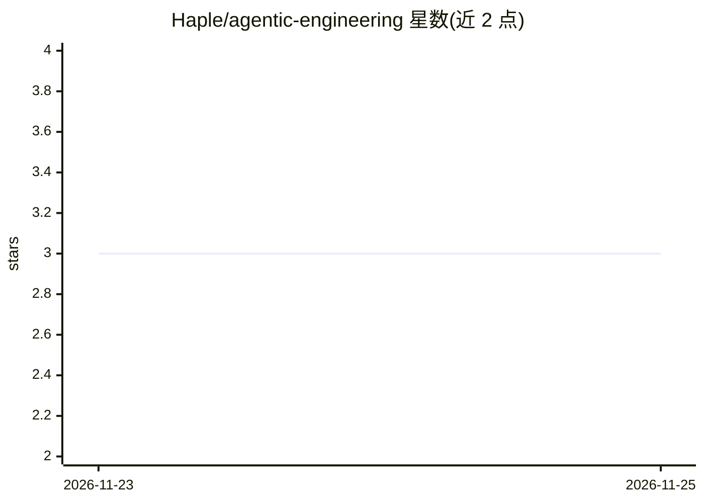

# Haple/agentic-engineering

⭐ 3 · JavaScript · NOASSERTION · 推送 2026-10-12 · [GitHub](https://github.com/Haple/agentic-engineering) · [官网](https://learn-agentic-engineering.pages.dev) · 个人维护

**面向开发者的 AI 编程 agent 工作流动画课程（24 课）**

免费的动画课程，教授使用 AI 编程 agent 构建软件的工作流：agent 运行原理、探索-计划-实现-验证的核心循环、记忆文件/技能/hooks 工具集、子代理与并行代理扩展、评测与提示注入安全等 6 个模块 24 课。内容提炼自 82 场演讲与 44 篇文章，每条论断附来源链接。课程同时以 agent skills 形式分发，可被编程 agent 直接读取或在 agent 内学习，本地运行需 Node 构建加 Python 静态服务器。

## 筛选速览

| 维度 | 判定 | 备注 |
|---|---|---|
| AI 角色 | `ai-knowledge` | 知识聚合/清单类 |
| 许可风险 | `none` | NOASSERTION |
| 部署形态 | `desktop` | 安装包/桌面程序 |
| 模型依赖 | — | README 未给出锁定关系 |
| 硬件要求 | — | 无带数字的原话,不猜 |
| 安装摩擦 | `low` | 无编译、无系统依赖或容器化 |
| 成熟度 | — | 结构信号不足 |

## 能力要点

- 24 课约 98 分钟，每条论断链接到 82 场演讲与 44 篇文章的原始出处
- 课程以 agent skills 形式分发，支持 npx skills add 与 Claude Code 插件市场安装
- 课程页面由 JSON 场景数据经 GSAP 引擎实时渲染，非视频文件
- 提供 /llms.txt、/llms-full.txt 与 course.json 供 agent 直接读取全部内容

## 适用场景

- 系统学习 AI 编程 agent 的核心工作流与质量把控方法
- 为团队引入 agent 编程实践提供培训材料
- 让自己的编程 agent 通过 skills 学习并遵循同一套实践

## 场景标签

`教程课程` · 领域:学习与行业

## 证据(README 行号)

> L4:  A free, animated course on building real software with AI coding agents.
> L6: 24 short lessons · ~98 minutes · distilled from 82 talks and 44 articles · every claim linked to its source.
> L32: The course ships as **agent skills**, so your coding agent follows the same practices you learn:

## 星数曲线

2026-11-23 3 → 2026-11-25 3（+0）

---
*卡片 v1 · prompt 1.4 · 生成 2026-11-23 · 置信度 high · 依据 README sha `678b888a1fa4` · [字段定义](../../DATASET.md)*
