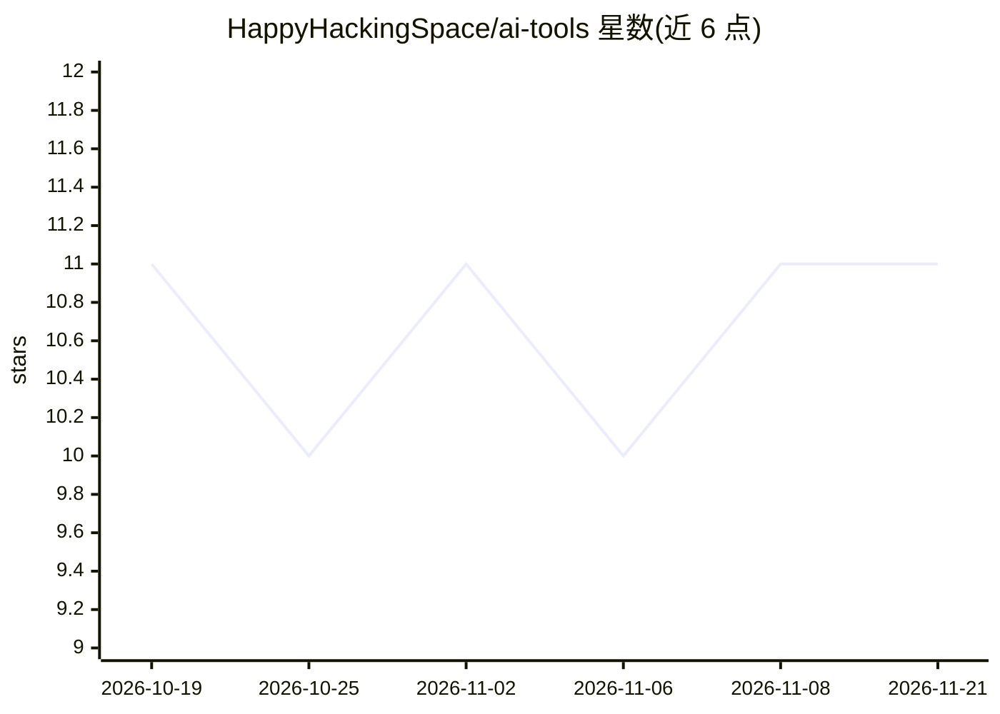

# HappyHackingSpace/ai-tools

⭐ 11 · MIT · 推送 2026-11-20 · [GitHub](https://github.com/HappyHackingSpace/ai-tools) · 个人维护

**按用例分类的 AI 应用策展清单，方便快速查找工具**

按使用场景分类的 AI 工具聚合清单，收录聊天机器人、图像生成与编辑、视频制作、音频与音乐生成、编程开发、文本分析与写作、金融商业等类别下的在线 AI 应用与工具，每个条目附一句功能描述。仓库本身不包含代码或模型，仅提供分类目录与简述，面向希望按用例查找 AI 工具的使用者。

## 筛选速览

| 维度 | 判定 | 备注 |
|---|---|---|
| AI 角色 | `ai-knowledge` | 知识聚合/清单类 |
| 许可风险 | `permissive` | MIT |
| 部署形态 | `None` |  |
| 模型依赖 | — | README 未给出锁定关系 |
| 硬件要求 | — | 无带数字的原话,不猜 |
| 安装摩擦 | `low` | 无编译、无系统依赖或容器化 |
| 成熟度 | — | 结构信号不足 |

## 能力要点

- 按 7 大用例类别（聊天/图像/视频/音频/编程/文本/商业）组织条目
- 覆盖闭源与开源工具（如 Stable Diffusion、Llama 3、Magenta、Continue.dev）
- 每个工具附一行功能定位描述

## 适用场景

- 按工作场景查找可用的 AI 工具
- 了解某类别（如视频生成、音乐生成）下有哪些工具可选
- 为团队工作流挑选 AI 应用作初步参考

## 场景标签

`精选清单` · 领域:学习与行业

## 证据(README 行号)

> L2: Welcome to AI Tools, a curated collection of cutting-edge AI-powered applications. This repository provides a compre
> L6: ### 1-Chatbots

## 星数曲线

2026-10-19 11 → 2026-11-21 11（+0）

---
*卡片 v1 · prompt 1.4 · 生成 2026-11-19 · 置信度 high · 依据 README sha `b3aca983f3ef` · [字段定义](../../DATASET.md)*
