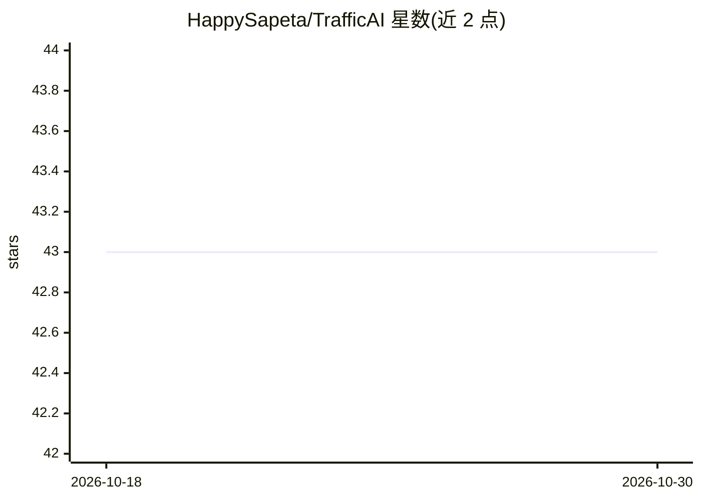

# HappySapeta/TrafficAI

⭐ 43 · C++ · MIT · 推送 2026-05-26 · [GitHub](https://github.com/HappySapeta/TrafficAI) · 个人维护

**UE5 大规模实时交通模拟项目，非 ML 的游戏 AI 车辆系统**

用 Unreal Engine 5 与 C++ 开发的大规模实时交通模拟项目，出于学习目的未使用 UE5 的 Mass Entity 框架，而是自建数据导向设计（DOD）方案。仿真系统以运动学自行车模型控制车辆转向与移动，用智能驾驶员模型（IDM）计算安全加速度防止碰撞，用 Craig Reynolds 路径跟随算法保持行进路线；辅以 Implicit Grid 空间加速结构做邻车查询、交叉路口信号灯管理器，以及双 LOD 表现层（实例化静态网格与可控 Actor 切换、PID 控制器锚定）。无主动避障机动，仅靠制动防碰撞。需 UE 5.2+，演示中的付费资源不在仓库内。

## 筛选速览

| 维度 | 判定 | 备注 |
|---|---|---|
| AI 角色 | `ai-enhanced` | 去掉 AI 部分产品仍成立 |
| 许可风险 | `permissive` | MIT |
| 部署形态 | `None` |  |
| 模型依赖 | — | README 未给出锁定关系 |
| 硬件要求 | — | 无带数字的原话,不猜 |
| 安装摩擦 | `low` | 无编译、无系统依赖或容器化 |
| 成熟度 | — | 结构信号不足 |

## 能力要点

- Kinematic Bicycle Model + IDM + Reynolds 路径跟随的车辆仿真组合
- DOD 数组化实体状态，CPU 上运行大规模模拟
- Implicit Grid 空间加速结构实现邻车快速查询
- 双 LOD 表现层：实例化静态网格与玩家可控 Actor 无缝切换

## 适用场景

- 学习开放世界游戏中的大规模交通模拟实现
- 在 UE5 项目中参考车辆仿真与路径跟随算法
- 研究数据导向设计在游戏 AI 中的应用

## 场景标签

 · 领域:游戏开发/交通仿真

## 证据(README 行号)

> L4: Inspired by modern open-world video games, this project was developed to learn the basics of a large-scale real-time
> L7: The goal was to learn about AI used in games and employ strategies that help simulate on a large scale.

## 星数曲线

2026-10-18 43 → 2026-10-30 43（+0）

---
*卡片 v1 · prompt 1.4 · 生成 2026-10-25 · 置信度 mid · 依据 README sha `df8b638ebcdc` · [字段定义](../../DATASET.md)*
