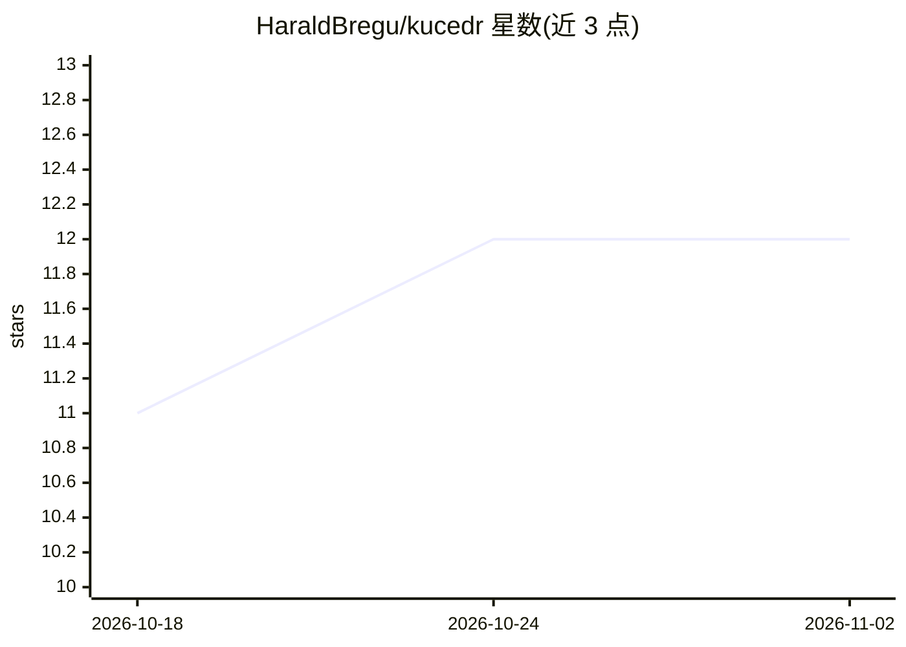

# HaraldBregu/kucedr

⭐ 12 · TypeScript · MIT · 推送 2026-11-01 · [GitHub](https://github.com/HaraldBregu/kucedr) · [官网](https://kucedr.com) · 个人维护

**跨平台桌面个人 AI 助手：对话驱动文件、研究与媒体创作**

基于 Electron 44 + React 19 的桌面 AI 助手应用，面向个人用户：在单一工作区内进行对话、文件读写与补丁、网页检索与浏览器自动化、生成图像/视频/音频、语音转录与朗读。支持为聊天、语音、媒体分别选择模型提供商并配置自有 API key；具备记忆、本地 RAG 知识库、MCP 服务器接入、子代理、定时任务与 Telegram 接入。数据默认存于本地 profile，账户可选。提供 Windows/macOS/Linux 安装包与便携版，也可从源码运行（Node.js 22.19+）。

## 筛选速览

| 维度 | 判定 | 备注 |
|---|---|---|
| AI 角色 | `ai-native` | 本体是模型或模型工具 |
| 许可风险 | `permissive` | MIT |
| 部署形态 | `desktop` | 安装包/桌面程序 |
| 模型依赖 | — | README 未给出锁定关系 |
| 硬件要求 | — | 无带数字的原话,不猜 |
| 安装摩擦 | `low` | 无编译、无系统依赖或容器化 |
| 成熟度 | — | 结构信号不足 |

## 能力要点

- 文件读写、命令执行、浏览器自动化等 agent 工具能力
- 聊天/语音/媒体可分别选择提供商与模型，使用自有 API key
- 本地 RAG 索引、持久记忆与 MCP/技能/子代理扩展
- 定时任务与健康检查自动化，Telegram 远程接入

## 适用场景

- 让 AI 助手代为总结文档、编辑项目文件、运行命令
- 用自然语言驱动研究与浏览并生成图像/音频/视频
- 把个人文件夹建成可检索的本地知识库

## 场景标签

`AI 助手` `RAG` `浏览器自动化` `图像生成` · 领域:效率与自动化

## 证据(README 行号)

> L19: Kucedr is a desktop AI assistant that brings conversation, tools, and your personal context into
> L42: - **Create media** — generate images, videos, music, and sound effects with your selected providers and models.
> L51: Kucedr runs on Windows, macOS, and Linux, with English and Italian interfaces and light, dark, and system themes.

## 星数曲线

2026-10-18 11 → 2026-11-02 12（+1）

---
*卡片 v1 · prompt 1.4 · 生成 2026-11-01 · 置信度 high · 依据 README sha `6c3529d65406` · [字段定义](../../DATASET.md)*
