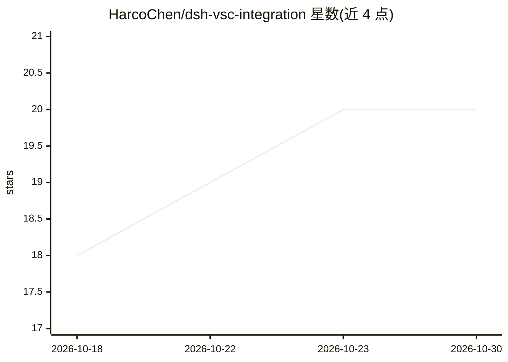

# HarcoChen/dsh-vsc-integration

⭐ 20 · TypeScript · MIT · 推送 2026-10-21 · [GitHub](https://github.com/HarcoChen/dsh-vsc-integration) · [官网](https://marketplace.visualstudio.com/items?itemName=HarcoChen.dsh-vsc-integration) · 个人维护 · 中文 README

**在 VS Code 中使用 DeepSeek Harness 编程代理的扩展**

将 DeepSeek Harness (DSH) 编程代理接入 VS Code 的扩展：通过官方 DeepSeek Desktop 应用启动 dsh Runtime，在 IDE 内对话执行编码任务，提供原生并排 Diff（无需 Git 仓库）、工具执行前的审批卡与拟写预览、持久会话与 Trace/token 用量面板，内置 Laya/Jev System One 决策插件（循环防护、完成校验等，默认关闭）。面向使用 DeepSeek 凭据的开发者，从 Marketplace/Open VSX 安装，另需 VS Code 1.106+ 与 Desktop 应用。

## 筛选速览

| 维度 | 判定 | 备注 |
|---|---|---|
| AI 角色 | `ai-native` | 本体是模型或模型工具 |
| 许可风险 | `permissive` | MIT |
| 部署形态 | `library` | 以包/库形式分发 |
| 模型依赖 | locked-api |  |
| 硬件要求 | — | 无带数字的原话,不猜 |
| 安装摩擦 | `low` | 无编译、无系统依赖或容器化 |
| 成熟度 | — | 结构信号不足 |

## 能力要点

- write/edit 工具调用后展示 VS Code 原生并排 Diff，通过重放 Session log 重建前像，非 Git 仓库也可用
- 审批卡显示命令行、工作目录与目标文件，支持写入前拟改预览
- 内置 Laya/Jev System One 决策：循环防护、结果折叠、完成校验、工具剪枝等，默认全关
- 持久会话管理、Trace/Todo/子代理/token 用量的 Activity 面板与账号余额显示

## 适用场景

- 在 VS Code 内通过对话让代理编写、修改并审查代码
- 执行命令和写入文件前逐项审批并预览拟改 Diff
- 附带 Git diff、选区或暂停的调试器状态发起任务
- 跨会话恢复任务并跟踪 token 消耗与账号余额

## 场景标签

`编码 Agent` · 领域:编码与开发

## 证据(README 行号)

> L6:  Bring DeepSeek Harness (DSH) into VS Code: work with your code, review native diffs, and follow each task with buil
> L51: 2. **Open chat.** Install and launch the official DeepSeek Desktop app, then open and trust your project folder and
> L53: 4. **Give it a task.** Type `@` to reference a file, or right-click a selection for DSH actions. Follow the task, r

## 星数曲线

2026-10-18 18 → 2026-10-30 20（+2）

---
*卡片 v1 · prompt 1.4 · 生成 2026-10-28 · 置信度 mid · 依据 README sha `92aabcbb8abd` · [字段定义](../../DATASET.md)*
