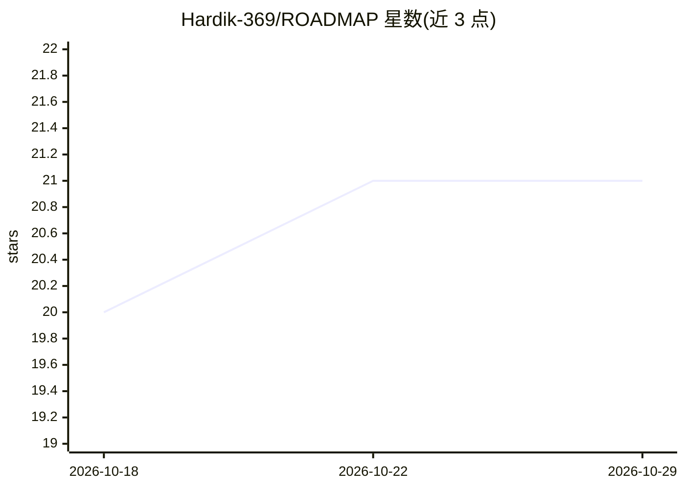

# Hardik-369/ROADMAP

⭐ 21 · 推送 2026-08-13 · [GitHub](https://github.com/Hardik-369/ROADMAP) · 个人维护

**零成本求职路线图合集：AI 工程师等 6 个科技岗位从入门到入职**

面向转行/求职者的职业路线图文档仓库，覆盖 AI Engineer、AI Governance Specialist、GTM Engineer、Product Engineer、Forward Deployed Engineer、DevOps Engineer 六个岗位。每个路线图为 20 部分的独立指南，包含职业概览、技能分级、24 周逐周计划、免费资源链接、免费证书清单、9 级项目路线、求职工具包、180 天行动计划与就绪度评分卡。设计为 5-6 个月、每日 4-6 小时投入，项目均可使用免费额度与开源工具完成。纯文档内容，无安装或运行要求。

## 筛选速览

| 维度 | 判定 | 备注 |
|---|---|---|
| AI 角色 | `ai-knowledge` | 知识聚合/清单类 |
| 许可风险 | `none` | — |
| 部署形态 | `None` |  |
| 模型依赖 | — | README 未给出锁定关系 |
| 硬件要求 | — | 无带数字的原话,不猜 |
| 安装摩擦 | `low` | 无编译、无系统依赖或容器化 |
| 成熟度 | — | 结构信号不足 |

## 能力要点

- 6 个岗位的 20 部分独立路线图
- 24 周逐周计划与 180 天逐日行动计划
- 免费资源与免费证书的策展清单
- 9 级项目路线与求职工具包（简历/作品集/面试）

## 适用场景

- 按岗位自学并规划 5-6 个月的求职准备
- 查找各岗位的免费课程、证书与工具清单
- 按项目路线从入门做到开源贡献以充实简历

## 场景标签

`教程课程` `精选清单` · 领域:学习与行业

## 证据(README 行号)

> L3: Comprehensive, zero-budget, job-ready roadmaps for the fastest-growing roles in AI, engineering, and revenue operati
> L5: ## Included Roadmaps

## 星数曲线

2026-10-18 20 → 2026-10-29 21（+1）

---
*卡片 v1 · prompt 1.4 · 生成 2026-10-28 · 置信度 high · 依据 README sha `cb9f2f32f0cd` · [字段定义](../../DATASET.md)*
