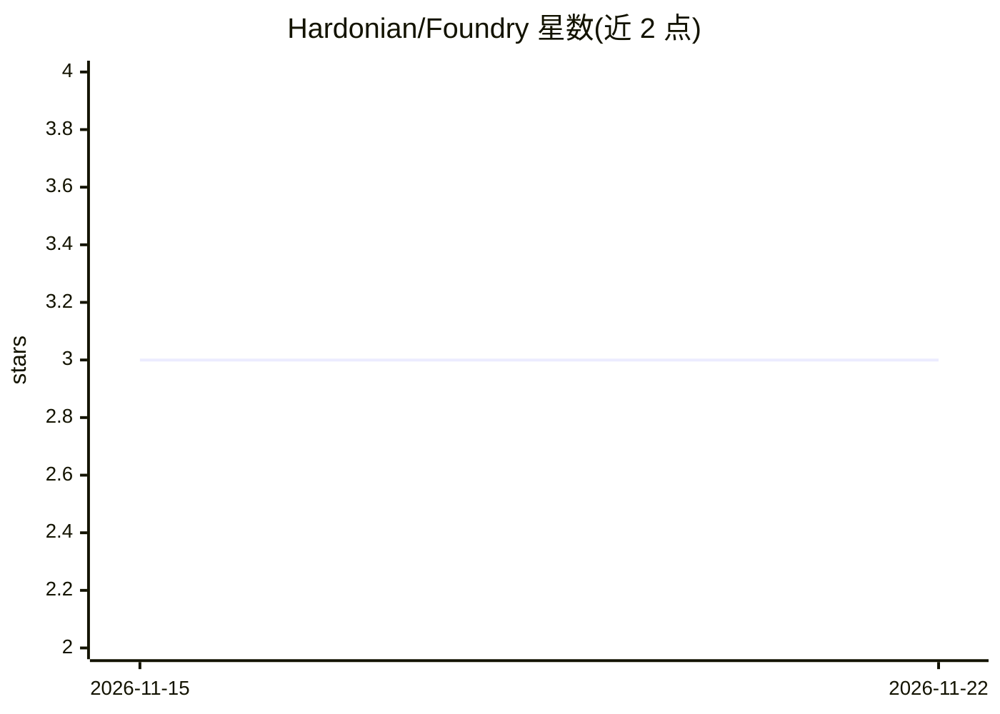

# Hardonian/Foundry

⭐ 3 · Python · Apache-2.0 · 推送 2026-11-19 · [GitHub](https://github.com/Hardonian/Foundry) · 个人维护

**给 AI agent 模型生命周期提供防篡改证据与 fail-closed 晋升门禁的 Python 工具**

面向 AI agent 流水线的模型生命周期治理工具：评估运行被记录为哈希链防篡改账本，模型晋升在证据不完整或被篡改时拒绝通过（BLOCKED，exit 2），证据完整并签名后进入人工复核（ALLOWED_REVIEW_REQUIRED）。机制包括数据集校验、安全/许可/资源 preflight、M-of-N Ed25519 keyring 验证、外部锚点、SHA-256 证据包与本地模型注册表。以 CLI、Python SDK 和源码安装形式提供，内置合成数据案例研究；README 自述处于 research baseline 阶段，v0.2.0 晋升门禁存在漏洞需升级。

## 筛选速览

| 维度 | 判定 | 备注 |
|---|---|---|
| AI 角色 | `ai-ecosystem` | LLM/agent 周边工具 |
| 许可风险 | `permissive` | Apache-2.0 |
| 部署形态 | `library` | 以包/库形式分发 |
| 模型依赖 | — | README 未给出锁定关系 |
| 硬件要求 | — | 无带数字的原话,不猜 |
| 安装摩擦 | `low` | 无编译、无系统依赖或容器化 |
| 成熟度 | `idea` | |

## 能力要点

- 哈希链 run 账本 + M-of-N Ed25519 keyring 验证的防篡改运行记录
- fail-closed 晋升门禁：证据缺失/无效即 BLOCKED，人工复核为必经环节
- 数据集完整性/泄漏/切分校验与安全/许可/资源 preflight 检查
- 可选离线 LoRA 训练栈（torch/transformers/peft）与 SHA-256 模型注册表

## 适用场景

- 为 agent 工具调用或金额相关判断类模型部署提供可出示的证据链
- 团队按 keyring 多人签名与人工复核流程治理模型上线
- 对已提交的签名评估证据链做离线重放与来源核验

## 场景标签

`模型评测` `MLOps` · 领域:评测与运维

## 证据(README 行号)

> L8: **Evidence-first model lifecycle for AI agents.** Every evaluation run becomes a tamper-evident record, and model pr
> L16: Foundry makes that evidence the gate. Dataset validation, preflight safety/licensing/resource checks, hash-chained 
> L18: Promotion is the interesting output. Missing or invalid evidence blocks it (`BLOCKED`, exit `2`); eligible runs wit

## 星数曲线

2026-11-15 3 → 2026-11-22 3（+0）

---
*卡片 v1 · prompt 1.4 · 生成 2026-11-22 · 置信度 high · 依据 README sha `972bb86c343b` · [字段定义](../../DATASET.md)*
