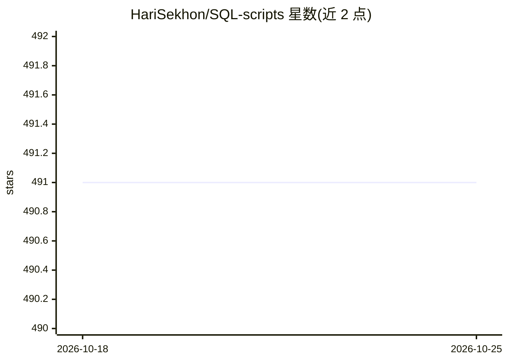

# HariSekhon/SQL-scripts

⭐ 491 · Shell · MIT · 推送 2026-02-03 · [GitHub](https://github.com/HariSekhon/SQL-scripts) · 个人维护

**100+ 数据库 SQL 脚本集：面向 DBA 与分析的即用查询**

从 DevOps Bash tools 拆分出的 SQL 脚本仓库，按 DevOps/DBA 与 Analytics 组织：覆盖 PostgreSQL（8.4–13.x）、MySQL（5.5–8.0）/MariaDB、Oracle（9i–19c）、AWS Athena（CloudTrail DDL）与 Google BigQuery（账单、information schema、BigQuery ML 逻辑回归分类与购买预测）。配合 DevOps Bash tools 的 docker 一键脚本可快速启动 mysql/psql 环境测试脚本；另链接配套的数据库连接与批量执行 shell 脚本及 SQL 知识库。

## 筛选速览

| 维度 | 判定 | 备注 |
|---|---|---|
| AI 角色 | `ai-knowledge` | 知识聚合/清单类 |
| 许可风险 | `permissive` | MIT |
| 部署形态 | `self-host` | docker 或自建部署 |
| 模型依赖 | — | README 未给出锁定关系 |
| 硬件要求 | — | 无带数字的原话,不猜 |
| 安装摩擦 | `low` | 无编译、无系统依赖或容器化 |
| 成熟度 | — | 结构信号不足 |

## 能力要点

- 跨 PostgreSQL/MySQL/MariaDB/Oracle/Athena/BigQuery 六种数据库的即用脚本
- BigQuery ML 逻辑回归分类模型与购买预测示例
- 脚本在多个数据库版本上实测（如 PostgreSQL 8.4–13.x）
- 可配合 DevOps Bash tools 的 docker 脚本一键启动测试环境

## 适用场景

- DBA 排查数据库问题与性能调优时直接取用查询
- 分析 GCP 账单、数据集结构与电商购买预测
- 在 docker 环境中快速试验 SQL 脚本

## 场景标签

`数据分析` · 领域:效率与自动化

## 证据(README 行号)

> L47: Useful SQL scripts, split from DevOps Bash tools, for which this is now a submodule.
> L82:  - analytics/`bigquery_*.sql` - ecommerce queries and BigQuery ML machine learning classification logistic regressi

## 星数曲线

2026-10-18 491 → 2026-10-25 491（+0）

---
*卡片 v1 · prompt 1.4 · 生成 2026-10-21 · 置信度 mid · 依据 README sha `e2e7752c6c7e` · [字段定义](../../DATASET.md)*
