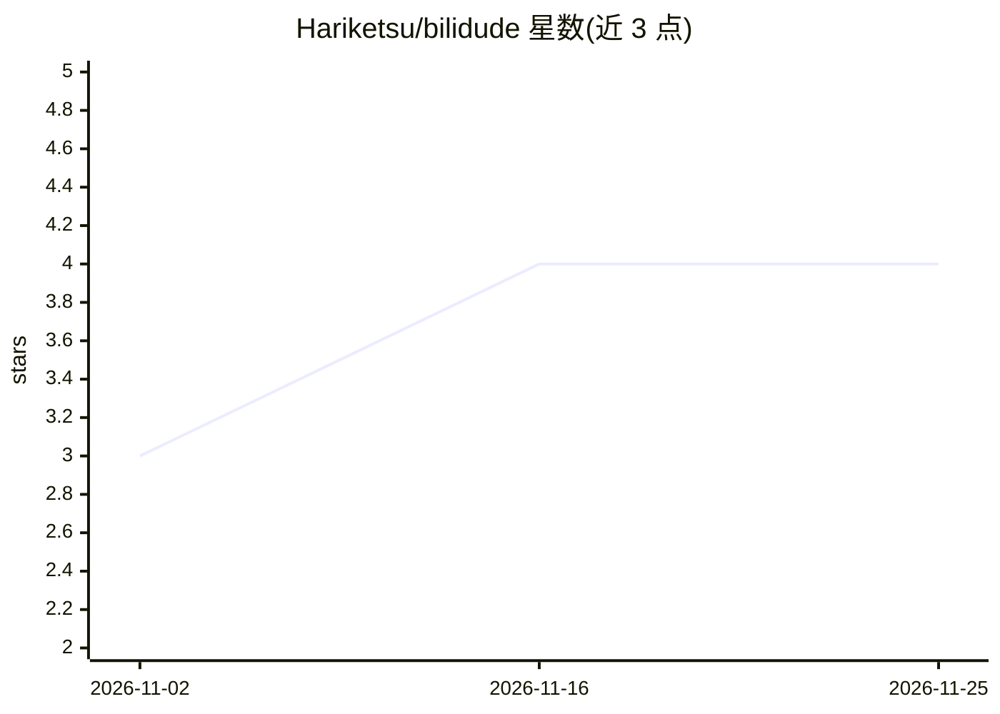

# Hariketsu/bilidude

⭐ 4 · TypeScript · GPL-3.0 · 推送 2026-11-22 · [GitHub](https://github.com/Hariketsu/bilidude) · 个人维护 · 中文 README

**Chrome 侧边栏扩展：用自己的大模型总结和提问 B 站视频**

BiliDude 是一个 Chrome 扩展，读取当前 B 站视频的字幕并发给用户选择的模型服务商，回答视频相关问题，支持一键生成总结、目录或金句，回答中的时间戳可点击跳转视频。无字幕视频可先经音频转写服务转写。内置 DeepSeek、OpenAI、Anthropic、Gemini、OpenRouter，也可接任何 OpenAI 兼容接口；无服务器，API Key 与对话记录保存在浏览器本地。需手动加载安装，需登录 B 站获取 AI 字幕。

## 筛选速览

| 维度 | 判定 | 备注 |
|---|---|---|
| AI 角色 | `ai-native` | 本体是模型或模型工具 |
| 许可风险 | `viral` | GPL-3.0 |
| 部署形态 | `None` |  |
| 模型依赖 | local-ok | 支持本地模型 |
| 硬件要求 | — | 无带数字的原话,不猜 |
| 安装摩擦 | `low` | 无编译、无系统依赖或容器化 |
| 成熟度 | — | 结构信号不足 |

## 能力要点

- 读取 B 站视频字幕交由用户自选的大模型生成总结、目录、金句与问答
- 回答中的时间戳点击即跳转视频对应位置
- 内置多家服务商并可接任何 OpenAI 兼容接口，各服务商可改 Base URL
- 无字幕视频可经 OpenAI、Groq、阿里云百炼、硅基流动等服务转写音频

## 适用场景

- 给长视频快速生成总结和目录，点时间戳回看关键片段
- 边看 B 站视频边向大模型提问
- 为没有字幕的视频先转写音频再问答

## 场景标签

`语音识别` · 领域:感知与多模态

## 证据(README 行号)

> L24: BiliDude 是一个 Chrome 扩展。它读取当前视频的字幕，交给你选的大模型，然后回答关于这个视频的问题。可以一键要总结、目录或金句，也可以直接问。回答里的时间戳点一下，视频就跳过去。
> L40: 点工具栏上的图标打开侧边栏，第一次使用时选一个模型服务商并填入 API Key。内置 DeepSeek、OpenAI、Anthropic、Google Gemini 和 OpenRouter，也可以接任何 OpenAI 兼容接口，

## 星数曲线

2026-11-02 3 → 2026-11-25 4（+1）

---
*卡片 v1 · prompt 1.4 · 生成 2026-11-21 · 置信度 high · 依据 README sha `f36bb9a7b22e` · [字段定义](../../DATASET.md)*
